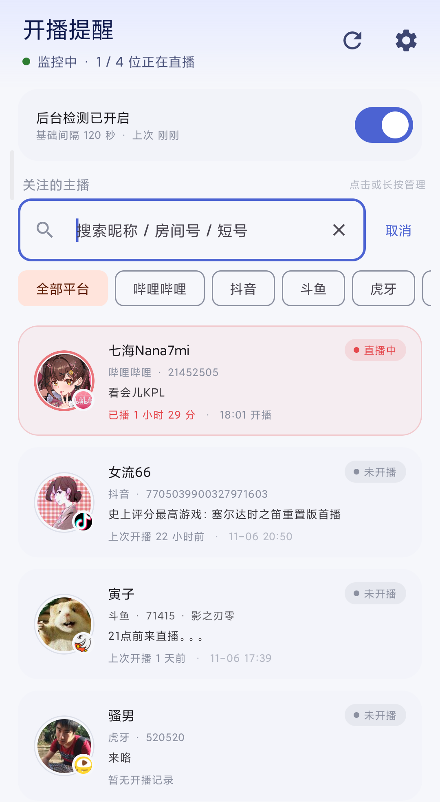
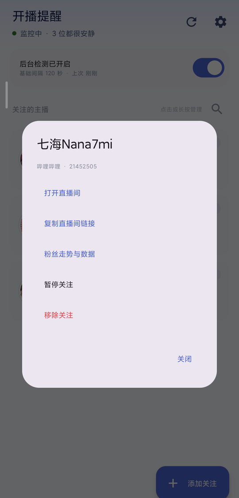
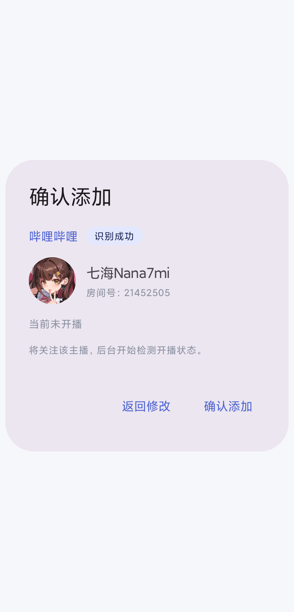
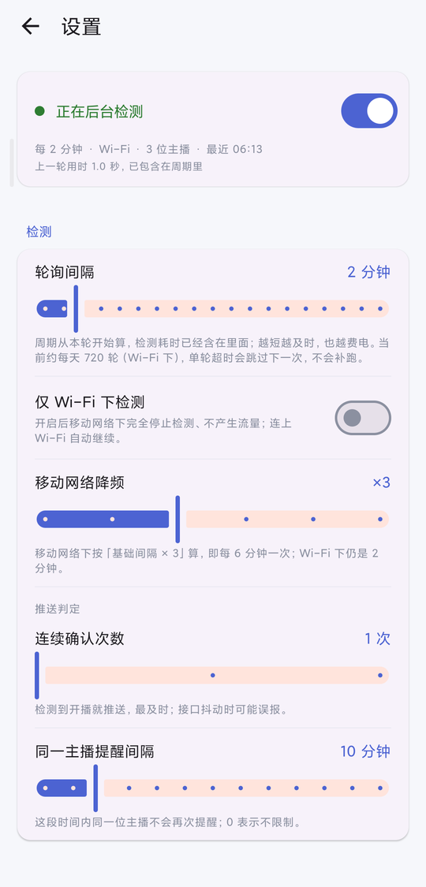
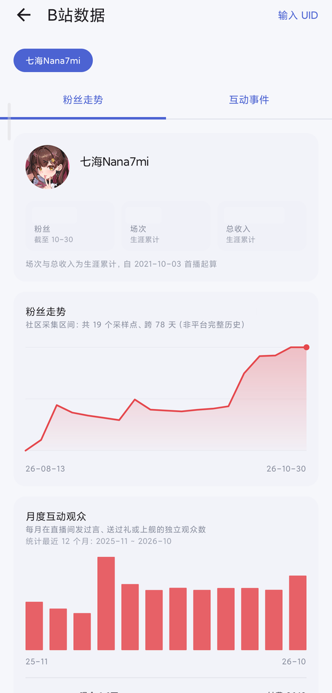
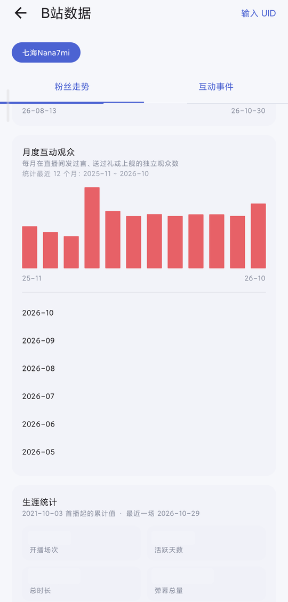
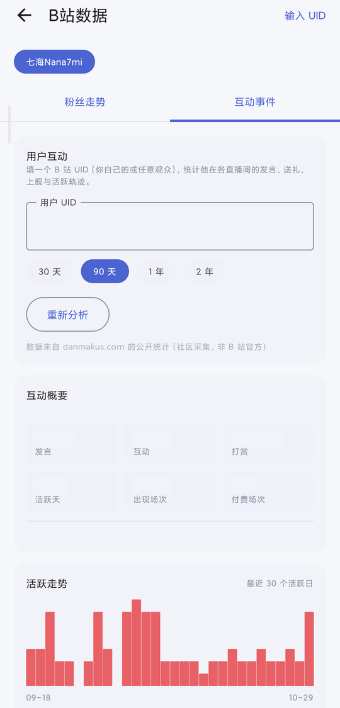

<div align="right">

<a href="README.md">简体中文</a> · <b>English</b>

</div>

<p align="center">
  
</p>

<h1 align="center">开播提醒 · LiveNotify</h1>

<p align="center">
  <b>One notification, straight to the live room, the moment a streamer you follow goes live.</b><br />
  An open-source, multi-platform live-stream reminder for Android · no account · no server · no telemetry
</p>

<p align="center">
  <a href="https://github.com/xyzOvO/LiveNotify/releases/latest"></a>
  <a href="https://github.com/xyzOvO/LiveNotify/stargazers"></a>
  <a href="https://github.com/xyzOvO/LiveNotify/blob/main/LICENSE"></a>
  
  
  
  
</p>

<p align="center">
  <a href="#download">📲 Download</a> ·
  <a href="#features">✨ Features</a> ·
  <a href="#ui">🖼 Screens &amp; UI</a> ·
  <a href="#platforms">🎯 Platforms</a> ·
  <a href="#build">🛠 Build</a> ·
  <a href="#faq">❓ FAQ</a> ·
  <a href="#internals">🧩 How It Works</a> ·
  <a href="#bili-stats">📈 Bilibili Stats</a> ·
  <a href="#compliance">⚖️ Compliance</a> ·
  <a href="#license">📄 License</a>
</p>

<!-- 居中 + 自适应：GitHub 的 markdown-body 对 img 应用 max-width:100%，窄屏自动缩小，不需要内联 style -->
<p align="center">
  
</p>
<p align="center">
  <sub><b>Home screen (search expanded)</b> · sticky search field / filter chips / four platform cards · closing search reveals the magnifier entry (see <a href="#ui">🖼 Screens &amp; UI</a>)</sub>
</p>

Supports **Bilibili / Douyin / Douyu / Huya**. A foreground service polls in the background (120 seconds by default), posts a local notification when someone goes live, and **tapping it opens the live room directly**. Each card shows "live for…" or "last live 5 days ago", so the state of every platform is visible at a glance.

There is also an optional **Bilibili stats page**: follower history, monthly audience trends, career totals, and interaction analysis for any UID (messages / gifts / active hours / favourite rooms). Every number is labelled with its statistical scope — lifetime totals are never presented as "last month".

> [!WARNING]
> **LiveNotify is free and open source, forever.** If you paid for it anywhere, you were scammed — request a refund. Any paid build is a repackaged fraud and has nothing to do with this project.

> [!NOTE]
> Released under the **MIT License** (keep the copyright notice when reusing code). This is a **personal Android app** with no affiliation, partnership, or authorisation from any streaming platform. Platform names and icons are used only to identify the source platform; trademarks belong to their respective owners. **The in-app UI is Chinese only** — this English README documents that Chinese interface; no English locale is shipped.

---

<a id="download"></a>

## 📲 Download

> **Requires Android 8.0 (API 26) or newer.** The APK is release-signed, so allow "install unknown apps" for the first install.

- Grab `app-release.apk` from **[Releases](https://github.com/xyzOvO/LiveNotify/releases/latest)** — signed with the release key, ready to install
- Or build it yourself (see [🛠 Build](#build))

Two things to do after installing, or notifications may never arrive:

1. **Allow notifications**: Android 13+ asks on first launch; if you dismissed it, enable it under System Settings → Apps → Notifications.
2. **Allow background execution**: turn off battery optimisation in the app's settings and whitelist it in the system "Auto-start / background run" list (especially on MIUI / ColorOS / HarmonyOS).

To add a streamer: tap **+** at the bottom right and paste a room URL or a room ID, e.g.
`https://live.bilibili.com/21452505`, `https://live.douyin.com/629458933`, `https://www.douyu.com/71415`, `https://www.huya.com/520520`.

> When you pick a platform manually, **a plain numeric room ID is enough** on all four platforms — no need to hunt down a URL first.

---

<a id="features"></a>

## ✨ Features

### 🔎 Polling & Scheduling

| Feature | Details |
|---|---|
| **Multi-platform** | Bilibili / Douyin / Douyu / Huya behind a pluggable platform layer — adding one means implementing a single interface |
| **Fixed-period polling** | Set 120 s and the next round starts exactly 120 s after this round *started*; request time is already included. A round that overruns skips to the next slot instead of catching up with back-to-back runs |
| **No network, no requests** | When the active network fails the system connectivity check, the whole round is skipped: no requests, no error counters, no state changes. The foreground notification and home screen say "Waiting for network" (or "Waiting for Wi-Fi" when Wi-Fi-only mode is on) |
| **Three guards against false alarms** | State transition + consecutive confirmations + per-session deduplication, so a flaky network cannot fake a "just went live" event |
| **Battery & data friendly** | Bilibili's batch endpoint handles 20 streamers in one request; polling slows down on mobile data; optional Wi-Fi-only mode; zero requests while offline |
| **Honest status** | If the service is not running, notification permission is off, or a round was skipped, the UI says so explicitly instead of claiming "all quiet" |

### 🔔 Notifications & Catch-up

| Feature | Details |
|---|---|
| **Live notification** | Tapping it opens the live room; one notification per session, plus a cooldown |
| **Adjustable alert style** | Sound and vibration for live alerts can be toggled separately (notification channels on Android 8+) |
| **Hide the persistent notification** | A foreground service must keep one notification; it can be minimised to the lowest visibility or disabled entirely in the system channel settings |
| **Missed alerts are re-sent** | If notification permission or the live-alert channel is off, that session is *not* marked as notified. Once permission is back, the next round re-sends it; alerts older than 30 minutes are dropped (alerts suppressed by quiet hours never enter the queue at all) |
| **Quiet hours** | Optional night-time silence; polling keeps running, just with a longer interval |

### 📋 Follow List

| Feature | Details |
|---|---|
| **Last live time** | Cards show "Live for 1 h 23 m" or "Last live 5 days ago · 10-23 15:26" |
| **Search & filter** | Search by nickname or room ID, filter by platform, show live only; live result count and a one-tap "clear filters" / "add streamer" empty state |
| **Tap / long-press to manage** | Cards never navigate on their own — both gestures open the action sheet: open room / copy link / Bilibili stats / pause / remove |
| **Share-sheet import** | Share a live-room text from Bilibili, Douyin, etc. → choose "开播提醒" → the platform is detected and the field is prefilled; nothing is added until you confirm |
| **Pause / resume** | A paused card stays in the list but is not polled or notified; resuming aligns with the current session so an ongoing stream is not reported as new |
| **Backup & restore** | Export / import JSON to a local file for a new phone or a reinstall; cookies, live state and cooldowns are deliberately excluded. Import writes in a single transaction — any failure rolls the whole batch back and never overwrites existing notes or pause states |
| **Fully local** | No account, no server, no analytics. Everything lives in a local Room database |

### 📊 Data, Updates & Reliability

| Feature | Details |
|---|---|
| **Bilibili follower trends** | Long-press a Bilibili streamer → follower history chart, monthly interacting / paying / subscribing viewers, career totals (each block states its scope) |
| **Bilibili interaction events** | Enter any UID to see messages, gifts, subscriptions, active hours and favourite rooms |
| **Cached Bilibili stats** | The last successful result is stored locally: reopening shows the cache with an "updated X ago" label and keeps it even when stale; only a manual refresh hits the network, and a failed refresh keeps the old data |
| **In-app updater** | Silently checks GitHub Releases on launch: current vs. latest version side by side, full changelog, byte-level download progress, in-place retry, SHA-256 verification, signature comparison, then the system installer |
| **Data you can trust** | Migration tests run the full chain on real SQLite from v1 / v2 / v3, compare every column against the committed schema snapshot, and verify pause state and dedup fields row by row. Release CI also verifies the signing fingerprint and that versionName / versionCode match the tag |
| **Settings explain the impact** | Grouped into five sections: Polling / Notifications / Background permissions / Data / Other, with a status card showing the effective interval, last round duration (red when it overruns) and current network |

---

<a id="ui"></a>

## 🖼 Screens & UI

### 🧭 Home at a Glance

The cover screenshot reads top-to-bottom as follows. **One streamer per platform, unchanged from the screenshot — no names or room IDs were swapped**:

| # | Area | What it shows |
|---|---|---|
| 1 | Title bar | "开播提醒" plus refresh / settings icons; below it the status line reads "监控中 · N / 4 位正在直播" (N of 4 live) or "监控中 · 4 位都很安静" (all quiet), with a green or grey dot depending on the real state |
| 2 | Polling card | "后台检测已开启 / 基础间隔 120 秒 · 上次 刚刚" (polling on; base interval 120 s; last run just now) and an on/off switch. It says *base* interval because mobile data and quiet hours stretch it; "last run" follows the real check |
| 3 | List header | With search closed: "关注的主播" (followed streamers) + "点击或长按管理" + **the magnifier (search entry) on the right**. Once expanded the magnifier disappears; with filters active the right side shows "N / total" |
| 4 | **Search bar (after tapping the magnifier)** | A sticky input "搜索昵称 / 房间号 / 短号" (search nickname / room ID / short ID) with clear / close icons and a "Cancel" button; below it a horizontally scrollable chip row: All platforms / Bilibili / Douyin / Douyu / Huya / Live only |
| 5 | Streamer cards × 4 | See the table below |
| 6 | Bottom-right **+** | Add a streamer; hidden while search is open so the keyboard does not cover the results |

> The cover was re-shot on 2026-11-07 (updated again after v1.0.12) with **search expanded**: one streamer per platform, the same names and room IDs, and the search placeholder now matches the current build. At the time of the shot **七海Nana7mi was live** — her card has a soft red highlight and shows "Live for…" — while the other three were offline. The Douyin card shows the `web_rid` returned by the platform (its stable room identifier) — the Douyin number `629458933` in the example link points to the same streamer.

| Platform | Streamer | Room ID (example link) | When the cover was shot |
|---|---|---|---|
| **Bilibili** | 七海Nana7mi | `21452505` | 🔴 Live |
| **Douyin** | 女流66 | `629458933` | ⚪ Offline |
| **Douyu** | 寅子 | `71415` | ⚪ Offline |
| **Huya** | 骚男 | `520520` | ⚪ Offline |

Every card shows the avatar (with a platform badge in the bottom-right corner), nickname, platform and room ID, stream title (the previous stream's title while offline), live-time line and a state badge. While live, the whole card gets a soft red highlight and shows "Live for N h N m"; when offline it shows "Last live…" or "No live history yet".

### 👆 Interaction Map

| Area | Action | Behaviour |
|---|---|---|
| Home | Tap / long-press a card | Opens the same action sheet; the card itself never navigates, so accidental taps are harmless |
| Home | Pull to refresh / refresh icon | Runs a round immediately; the refresh icon spins and repeated taps are ignored while running |
| Home | Tap the magnifier next to the list header | Expands the sticky search bar and filter chips, and focuses the input |
| Search | Type a nickname / room ID / Bilibili short ID | Filters live, header shows "N / total"; the keyboard is dismissed automatically when you scroll the results |
| Search | Tap × in the input / "Cancel" / Back | With text: × clears it, a second tap closes search; "Cancel" and the Back key also close it — Back only collapses search, it never exits the app |
| Filter chips | Pick a platform / "Live only" | Filters stack; tap the same chip again to clear it. On narrow screens the chips scroll horizontally instead of eating half the screen |
| Empty result | "Clear filters" / "Add streamer" | Returns to the full list, or opens the add dialog directly |
| Action sheet | Open room / copy link / follower stats / pause or resume / remove | "Follower stats" appears for Bilibili streamers only; a paused card stays in the list but is not polled |
| Add | Bottom-right **+** | Paste a URL / room ID / a whole share text; platform can be forced (Auto / Bilibili / Douyin / Douyu / Huya) |
| Add | "识别主播" (Identify) → "确认添加" (Confirm) | **Identify first, confirm second**: the dialog shows platform, nickname, room ID and the resolved result. "返回修改" (Go back) returns to editing; nothing is written automatically |
| System share | Share a room text from another app → choose "开播提醒" | Prefills and detects the platform, still requires your confirmation |
| Settings | Status card | Whether the service is actually running, the effective interval, last round duration (red when it overruns), current network, last check time, followed-streamer count and quiet-hours state |
| Settings | Polling / Notifications / Background permissions / Data / Other | Polling: interval, Wi-Fi only, confirmation count; Notifications: sound & vibration, test notification, quiet hours, hide persistent notification, channel settings; Background permissions: auto-start, battery optimisation, notification permission with shortcuts, plus the "N live alerts pending re-send" notice; Data: backup & restore, Bilibili stats, Douyin cookie; Other: check for updates |
| Settings | Back key / back swipe | Returns to the home screen instead of leaving the app |
| Other · update card | "下载并安装" (Download & install) / "以后再说" (Later) | An inline card on the Settings page (not a dialog): current vs. latest version and the full changelog, byte-level progress; "Later" remembers that version, though a manual check still shows it |

Each avatar carries the official platform badge in its bottom-right corner. Live cards get a soft red highlight with a breathing outline, and relative timestamps refresh every 20 seconds.

<p align="center">
  
  
  
</p>
<p align="center">
  <sub><b>Action sheet</b> tap or long-press　·　<b>Add streamer</b> identify, then confirm　·　<b>Settings</b> real service state and the effect of every option</sub>
</p>

<p align="center">
  
  
  
</p>
<p align="center">
  <sub><b>Follower trends</b> overview / samples / monthly audience　·　<b>Career totals</b> since the first stream　·　<b>Interaction events</b> any UID<br/>Sample figures are redacted; scope labels are kept</sub>
</p>

> Every number is labelled with its scope: followers are "a snapshot as of MM-DD", sessions and total income are "lifetime", and the follower chart states "community collection window, N samples, spanning N days" — a third-party sample is never passed off as complete history. Endpoints and limits: [📈 Bilibili Stats](#bili-stats).

---

<a id="platforms"></a>

## 🎯 Supported Platforms

| Platform | Endpoint | Batch | Live start time |
|---|---|---|---|
| **Bilibili** | Official `get_status_info_by_uids` | ✅ 20 per request | Not returned while offline; accumulated locally |
| **Douyin** | Mobile webcast landing page (`status=2` = live) | ❌ One by one, 1.5 s throttle | ✅ `createTime` comes from the page |
| **Douyu** | `open.douyucdn.cn/api/RoomApi/room/{rid}` | ❌ 1.2 s throttle | ✅ `start_time`, so "last live" works right after adding |
| **Huya** | `mp.huya.com/cache.php?m=Live&do=profileRoom` | ❌ 1 s throttle | ❌ Not returned; only local observation |

> Douyin offers no personal-use room status API. This project parses the mobile landing page at `webcast.amemv.com` (no login, no signature, ~90 KB per request).
> That is **unofficial page scraping**: a redesign can break it. You may paste a browser cookie in Settings to improve success rate (stored locally only).
> Short links from `v.douyin.com` in share texts are followed automatically to that landing page — paste the whole text as-is.

---

<a id="build"></a>

## 🛠 Build

**Requirements**: JDK 17, Android SDK (`compileSdk 35` / `minSdk 26`), Gradle 8.9 (wrapper included).

> ⚠️ Keep the project in a **pure ASCII path** (e.g. `D:\LiveNotify`). AGP on Windows rejects non-ASCII paths (`Your project path contains non-ASCII characters`). The `android.overridePathCheck=true` flag is only a fallback; lower-level tools may still fail.

### 💻 Command line

```bash
./gradlew assembleDebug      # macOS / Linux
gradlew.bat assembleDebug    # Windows
# Output: app/build/outputs/apk/debug/app-debug.apk
```

> If the Gradle distribution downloads slowly, point `gradle/wrapper/gradle-wrapper.properties` at
> `https://mirrors.cloud.tencent.com/gradle/gradle-8.9-bin.zip`.

### 🧰 Android Studio

`File → Open` the project root → wait for `Sync Now` → connect a device and press Run.

### 🔑 Signing (optional)

**Local builds**: without `keystore.properties`, the debug key is used, so anyone can clone the repo and build an installable APK. To use your own key:

```bash
keytool -genkeypair -v -keystore keystore/livenotify.jks -alias livenotify \
        -keyalg RSA -keysize 2048 -validity 10950
```

Then create `keystore.properties` in the project root (both this file and `keystore/` are in `.gitignore`):

```properties
storeFile=keystore/livenotify.jks
storePassword=your_password
keyAlias=livenotify
keyPassword=your_password
```

Its presence switches local builds to the release key. To give CI the same key, store the `.jks` as base64 in repository Secrets:

| Secret | Value |
|---|---|
| `KEYSTORE_BASE64` | base64 of `keystore/livenotify.jks` (`base64 -w0` or PowerShell `[Convert]::ToBase64String(...)`) |
| `KEYSTORE_PASSWORD` | `storePassword` |
| `KEY_ALIAS` | `livenotify` |
| `KEY_PASSWORD` | `keyPassword` |

> [!IMPORTANT]
> **Release builds must never downgrade the signing key.** Local debug builds are unaffected, but the tag-triggered release workflow **requires all four secrets** and fails outright if any is missing — no publishable APK is produced. It then compares the APK's SHA-256 signing fingerprint byte for byte, and checks that `versionName` / `versionCode` match the tag and exceed the previous version, so consecutive releases always install over one another. Rotating the key means every existing user loses in-place upgrades; update the fingerprint in the workflow and announce it in the release notes.

---

<a id="faq"></a>

## ❓ FAQ

**Q: Polling stops after a reboot — why?**
Many Chinese ROMs block third-party auto-start by default, so the boot broadcast never reaches the app (this cannot be worked around in code). Add it to the whitelist under Settings → Background permissions → Auto-start and set the battery policy to "Unrestricted". Another cause is a system "Force stop": after that, no broadcast is delivered until the app is opened manually once.

**Q: There is always a "polling" notification. Can I remove it?**
Android requires it for a foreground service, so the app cannot delete it. Two options: enable "Hide persistent notification" in Settings to minimise it (silent, no heads-up, no badge), or open the system channel page via "Persistent notification settings" and turn off the "Background polling" channel entirely — polling keeps running.

**Q: The service gets killed after a while.**
That is a vendor ROM restriction, not an app bug. Whitelist auto-start / battery optimisation / background run in system settings.

**Q: How do I close search, and can a filter lose my streamers?**
Tap "Cancel", tap × in the input (with text it clears first; a second tap closes), or press Back — Back only collapses search and never exits the app. Filters affect **only what is currently displayed**: polling and the persistent notification always read the full list, so pause and live states are untouched.

**Q: A streamer is missing from search results.**
Search matches nicknames, room IDs and Bilibili short IDs (`short_id`, shown on the card as a "短号 N" note), and a partial string is enough. Check whether a platform chip or "Live only" is still active. The empty state offers "Clear filters" and "Add streamer" shortcuts.

**Q: The updater says the signature does not match.**
An update must share the installed build's signing key to install over it. If you previously installed an early debug-signed CI build, you must uninstall once before moving to the release-signed build; from then on, same-key versions upgrade in place and your follow list is kept. The dialog explains the reason and the only way out: export a backup in Settings, uninstall, reinstall, then import it.

**Q: Why is the changelog sometimes empty?**
Release notes come from the GitHub API first. When `api.github.com` returns 403 (shared egress IPs, rate limits), the app falls back to the Releases page: notes are recovered from `releases.atom`, while the version and APK URL come from the `/releases/latest` 302 redirect. If both fail it shows "No release notes" — downloading and installing still work.

**Q: Will it nag me after I choose "Later"?**
No. That version is remembered and skipped by the automatic check; only a newer version prompts again. A manual "Check for updates" still shows it whenever you change your mind.

**Q: Why verify SHA-256 before installing?**
GitHub Release assets carry a `digest` (`sha256:<hex>`). After downloading, the file hash is recomputed; a mismatch deletes the file, retries, and reports "APK verification failed". The signature check answers "is it from the same author?", the file hash answers "did this copy arrive intact?" — they complement each other. When the Releases-page 302 fallback yields no digest, the file check is skipped but the signature comparison still runs.

**Q: Why is "last live" empty?**
Only platforms whose API returns a start time (Douyu, Douyin) can show it immediately. Bilibili and Huya need the app to observe one live session first.

**Q: Douyin keeps saying "page structure may have changed".**
Douyin redesigned the page. Open `https://webcast.amemv.com/douyin/webcast/reflow/<room_id>` with a mobile UA in a browser to see whether data is still available; a cookie in Settings can also help.

**Q: Pasting a Douyin share text does not work.**
It normally does: `v.douyin.com` short links are followed to the real room URL, and the room ID is the number in `reflow/<digits>`. If it still fails, the stream has probably ended or the short link expired — share it again from Douyin.

**Q: How large is the detection delay?**
120 seconds by default, measured from one round's start to the next — the request time is already inside the period, so "2 minutes" never becomes "2 and a half". If a round overruns the period, the missed slots are skipped rather than replayed back to back.

**Q: Two rounds are further apart than the configured interval.**
Check "Last round duration" on the Settings status card. If it exceeds the interval it is marked red and a round really was skipped — usually Douyin's per-streamer requests on a weak network. Increase the interval or reduce the number of followed streamers.

**Q: Does it keep requesting while offline?**
No. When the network fails the system connectivity check (disconnected, no egress, captive portal), the whole round is skipped: no request is sent and error counters are untouched. The persistent notification, home status line and Settings say "Waiting for network" and switch back as soon as connectivity returns — no need to wait for the next round.

**Q: How do I reduce battery usage?**
Enable "Wi-Fi only" in Settings, lengthen the interval, and set quiet hours at night.

**Q: I had notifications off when a stream started — will I still get it after turning them on?**
Yes, as long as the stream has not been running too long. An alert that could not be delivered is not marked "already notified"; it becomes a pending record (Settings shows "N live alerts could not be delivered because notifications were off"), and the next round re-sends it. The catch-up notification says "Now live" and "started about N minutes ago" instead of pretending it just started. After **30 minutes** it is dropped — a late "went live" is more annoying than useful. Alerts suppressed by quiet hours are excluded and never burst out afterwards.

---

<a id="internals"></a>

## 🧩 How It Works

### 🤔 Why native Android

| Option | Strength | Why not |
|---|---|---|
| **Native Android (this project)** | Foreground service, notification channels, Doze / battery behaviour under direct control; fine-grained power tuning | Android only; iOS needs a separate app |
| Flutter / RN | One codebase, two platforms | 1–3 minute polling still needs a native foreground service, so the cross-platform layer ends up with a native plugin anyway, and OEM background quirks get harder to debug |

**If iOS must be supported, write a separate native iOS app or rewrite in Flutter. For Android-only, native has the fewest surprises.**

### ⏱ Why a foreground service instead of WorkManager

`PeriodicWorkRequest` has a **15-minute minimum period** and Doze delays it even further, so 1–3 minute polling is impossible. The loop runs inside `MonitorService` (`foregroundServiceType="specialUse"`): it records the round's start time, waits until "start + period" for the next round, and skips to the following slot when a round overruns. If 15+ minutes is acceptable, swapping in a `PeriodicWorkRequest` removes the persistent notification — `MonitorEngine.runOnce()` is a plain suspend function, so both schedulers are interchangeable.

`specialUse` rather than `dataSync`: Android 15 caps `dataSync` at **6 hours of cumulative runtime per 24 hours** and silently stops the service afterwards. A live reminder must run around the clock, so `specialUse` (with the use case declared in the manifest) is the only fit.

### 🗂 Project layout

```
app/
├── schemas/                  Room schema snapshots for every version (migration test baseline)
└── src/main/java/com/example/livenotify/
    ├── LiveNotifyApp.kt      Application: dependency graph, channels, service startup
    ├── Graph.kt              Tiny hand-written DI (no Hilt)
    ├── data/
    │   ├── StreamerEntity.kt Room entity (dedup / debounce / pending-alert fields)
    │   ├── StreamerDao.kt    DAO (Flow observation + batch updates)
    │   ├── AppDatabase.kt    Room singleton (v1→v4 incremental migrations, single MIGRATION_SQL source)
    │   └── SettingsRepository.kt DataStore preferences
    ├── platform/
    │   ├── LivePlatform.kt   ★ Platform abstraction (implement + register to add one)
    │   ├── BilibiliPlatform.kt  Bilibili: official batch endpoint
    │   ├── DouyinPlatform.kt    Douyin: mobile webcast landing page fallback
    │   ├── DouyuPlatform.kt     Douyu: room_status / start_time parsing
    │   ├── HuyaPlatform.kt      Huya: liveStatus + realLiveStatus cross-check
    │   └── DouyinParser.kt      Landing-page parser (anchored on the room object) + risk detection
    ├── net/Http.kt           OkHttp wrapper + per-host throttling
    ├── bili/                 Bilibili stats: third-party endpoints + hand-written MessagePack decoder
    │   ├── BiliStatsApi.kt   All five statistics endpoints
    │   ├── StatsEndpoint.kt  Line selection (primary / mirror, remembers last success)
    │   ├── StatsCache.kt     Local cache: read first, network only on manual refresh
    │   └── MsgPack.kt        Hand-written MessagePack decoder (no dependency)
    ├── update/               In-app updater
    │   ├── UpdateApi.kt      Query GitHub Releases, parse version and APK URL
    │   ├── ReleaseNotes.kt   Strip Markdown noise for small screens
    │   ├── ReleasesAtom.kt   Recover release notes via releases.atom on API 403
    │   ├── ApkHash.kt        SHA-256 verification (asset digest)
    │   ├── ApkDownloader.kt  Streaming download with byte progress + old APK reuse + verification
    │   └── ApkInstaller.kt   Package / signature / version self-check + FileProvider installer
    ├── monitor/
    │   ├── MonitorEngine.kt  ★ Engine: batch fetch → compare → dedup → notify → persist
    │   ├── PollSchedule.kt   Single source of truth for periods (fixed slots, mobile factor, quiet hours)
    │   ├── NetworkState.kt   Connectivity (VPN decided by the underlying network; both misreads are unit-tested)
    │   ├── MonitorService.kt Foreground polling loop (specialUse, self-heals after task dismissal)
    │   ├── NotificationHelper.kt Channels and live notifications (tap opens the room)
    │   ├── PendingNotify.kt  Catch-up criteria (same session, validity window, give up)
    │   └── BootReceiver.kt   Boot receiver (ROM-restricted, fails silently)
    └── ui/                   Compose screens (home + search / add / settings / stats / updater)
```

**Adding a platform (e.g. Kuaishou)**: implement `LivePlatform` (`accept` recognises input, `resolve` produces a stable ID, `fetch` performs the query) → add one line to `PlatformRegistry.platforms` → **zero changes** to UI, database or engine.

### 🛡 Detection engine and the three guards

One round: read enabled entries → group by platform → call `platform.fetch()` → process each → batch write. A `Mutex` serialises rounds so background polling and manual refresh cannot double-notify.

1. **State transition**: only "was offline → now live" can trigger an alert;
2. **Consecutive confirmations**: N consecutive live observations before notifying (default 1, adjustable to 2–3). Until then `isLive` stays **false**, otherwise the second round would be blocked by "already live" and 2–3 confirmations would never notify;
3. **Session dedup + cooldown**: `lastNotifiedLiveStart` records the notified session; same session never repeats, plus a cooldown (default 10 minutes).

### 🚧 Edge cases

| Case | Handling |
|---|---|
| Network error / timeout | **Known state is untouched** ("could not fetch" ≠ "not live"); only the error counter grows, and cards turn red after 3 consecutive failures |
| No valid network for the round | No requests, no error counters, no state changes; UI and persistent notification say "Waiting for network / Waiting for Wi-Fi" |
| API change / parse failure | Marked non-retryable with a message; Douyin explicitly says "page structure may have changed" |
| Expired Douyin room / stream ended | The landing page degrades to an empty shell — treated as offline (better to miss than to false-alarm) |
| Bilibili rate limit (code -412 / -509) | Retryable, with the throttler enforcing a minimum interval |
| Streamer renamed / new avatar | Nickname, avatar, title and room URL are written back every round |
| Account deleted / room removed | Marked invalid, shown as "Invalid", no alerts, kept until the user removes it |
| Added while already live | Stored as live but **not notified immediately**; the next session triggers the alert |
| Duplicate add | Unique index `(platformId, anchorId)` |
| Session older than 20 hours (common for Douyin replay rooms) | Douyin reports `room_status` 1 with a `start_time` weeks old; **on every platform** the card then shows just "Live" instead of "Live for N hours" |
| UI is searching / filtering | Affects only visible rows; the engine and persistent notification always read the full list |

### 🕒 Where "last live" comes from

| State | Display | Source |
|---|---|---|
| Live | `Live for 1 h 23 m · started 15:26` | `liveStartAt` (this session's start) |
| Offline, with history | `Last live 5 days ago · 10-23 15:26` | `lastLiveStartAt` (previous session, kept forever) |
| Offline, no history | `No live history yet` | — |

`lastLiveEndAt` records the moment the engine observes a "live → offline" transition. Database v1→v4 uses only `ALTER TABLE ADD COLUMN`, so upgrading never drops the follow list; `MigrationSqlTest` runs the whole chain on real SQLite from v1 / v2 / v3 and checks every column.

### 🔋 Battery and data

- **Bilibili batch endpoint**: 20 streamers in one request, not 20 requests;
- Throttler: Bilibili 800 ms, Douyin 1500 ms;
- On mobile data the interval is multiplied by 3 (adjustable 1–6), and by another 5 during quiet hours; "Wi-Fi only" uses `TRANSPORT_WIFI`, not "is metered" as a proxy for network type;
- OkHttp connection pool reuse (3 connections / 5 minutes); 30-second backoff on errors.

---

<a id="verification"></a>

## 📊 Verification Log (2026-11-07)

| Item | Result |
|---|---|
| **DB migration v1→v4 automation** | ✅ Real SQLite from three starting points, every column checked against the schema snapshot; 133 unit tests pass, lint 0 errors |
| **Four-platform round** | ✅ 4 streamers across 4 platforms: `checked=4 notified=0 err=0` |
| **Search / filters / Settings back** | ✅ Action sheet, immediate check, search & filters, Back-to-collapse and swipe-back all verified on device |
| **Catch-up / in-app update** | ✅ On device: alerts re-sent after permission restored; v1.0.5 → v1.0.6 in-place upgrade with data intact |
| **Release signing check** | ✅ CI compares SHA-256 fingerprint byte for byte; `versionCode=10011` / `versionName=1.0.11` match the tag |

---

<a id="bili-stats"></a>

## 📈 Bilibili Stats (optional)

Long-press a Bilibili streamer → "粉丝走势与数据" (Follower trends & stats), or open it from Settings. Two parts:

**Follower trends**: follower-history chart, monthly interacting / new / returning / paying viewers, subscribers and gift value, plus career totals (sessions, active days, total duration, total messages, total income).

**Interaction events**: enter any Bilibili UID to see their message volume per room, gifts, active days, event-type breakdown, favourite rooms, a weekday × hour activity heatmap and frequent words. A **recent interactions** list follows — individual messages / gifts / subscriptions / super chats in reverse chronological order, each with its time and room.

Thanks to [danmakus.com](https://danmakus.com/): this page uses a public community-collected statistics API. **Coverage depends on what the community collected**; it is not official Bilibili data and requires no account login. The app labels the source on the interaction page too, and the API docs live at [/swagger/index.html](https://ukamnads.icu/swagger/index.html).

| Purpose | Endpoint |
|---|---|
| Streamer info + follower history | `GET /api/v2/channel?uId=` |
| Monthly audience trend | `GET /api/v2/channel/audience-trend?uId=` |
| Career totals | `GET /api/v2/wiki/channel/{uid}/career` |
| User interaction analysis | `POST /api/v3/user-analysis-jobs` → poll → `/result` (MessagePack) |
| Recent interactions (row by row) | `GET /api/v3/users/{userId}/history` (per-session messages / gifts) |

Things worth stating plainly:

- **Every number carries its scope**: followers are the latest snapshot ("as of MM-DD"); sessions, total income, total duration and total messages are **lifetime** totals from the first stream date reported by `career`; the follower chart states the **current collection window** (usually two or three months, a dozen samples) and depends on community coverage; monthly audience is fixed to the last 12 months; interaction analysis states the submitted time range.
- Requests carry only a uid — never your follow list and never any login state.
- An analysis job is a heavy server-side query, so it is **only started by tapping "Start analysis"**. Streamer data and successful results are cached locally; reopening shows the cache with its update time, and a failed refresh keeps the old data.
- **Automatic endpoint failover**: primary `ukamnads.icu` and mirror `api.ukamnads.icu` serve the same data. Network errors / 5xx / 429 trigger one retry on the other domain, and the working line is remembered (stored locally) and shown in the footer. 4xx and business errors do not switch — every node would answer the same. If all fail, the app says "stats service unavailable, live reminders are unaffected".
- An empty collection gets an explanatory empty state instead of an empty chart. Server structures may change without notice; paths are centralised in `bili/BiliStatsApi.kt`, domains in `bili/StatsEndpoint.kt`.
- These endpoints rate-limit per IP; rapid queries may return empty data or fail, and the UI explains it in plain language.
- You can ignore this feature entirely — it is not part of live detection and touches no local reminder data.

---

<a id="compliance"></a>

## ⚖️ Compliance & Risk Notes

1. This project is for **personal reminders for streamers you follow**. Data comes from public pages / public endpoints; nothing is stored-and-forwarded, redistributed, or used for commercial analysis.
2. The Douyin path is **unofficial page scraping**: keep request volume under control (throttled by default) and do not use it for bulk collection. A site redesign can break it — in that case disable the path or apply for official enterprise access.
3. The Douyin cookie is **optional**, stored only in local DataStore and never uploaded; the app sets `allowBackup=false` (no system / cloud backup) and masks it by default in Settings.
4. The notification small icon is a monochrome PNG; if your ROM renders it badly, replace `drawable-*/ic_notification.png` — no code change needed.
5. **Trademarks & icons**: `drawable-*/ic_platform_*.png` are official platform icons; trademarks belong to their owners and this project claims no rights. If you are a rights holder and object, please open an issue and I will remove them immediately. For commercial distribution, replace them with neutral icons.

---

<a id="license"></a>

## 📄 License

[MIT](LICENSE) © 2026 gjkt

---

<a id="credits"></a>

## 🙏 Credits

- Bugs and suggestions: [GitHub Issues](https://github.com/xyzOvO/LiveNotify/issues)
- Changelog and older builds: [Releases](https://github.com/xyzOvO/LiveNotify/releases)
- Bilibili stats come from the community collection at [danmakus.com](https://danmakus.com/); public endpoints are maintained by their respective platforms.
- Avatars, icons and other artwork belong to their original authors.
