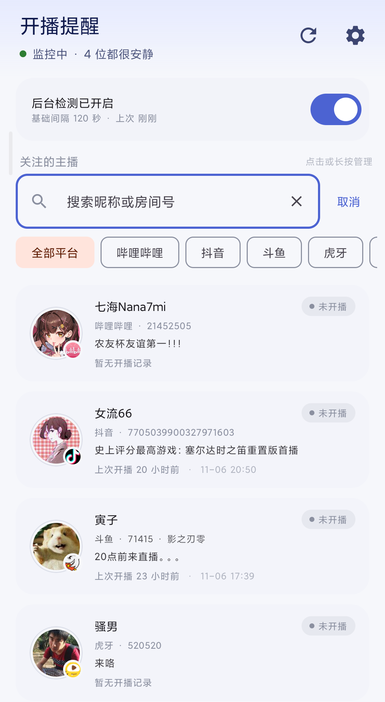
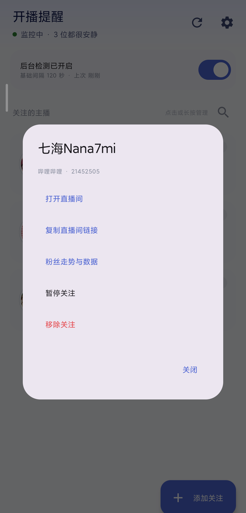
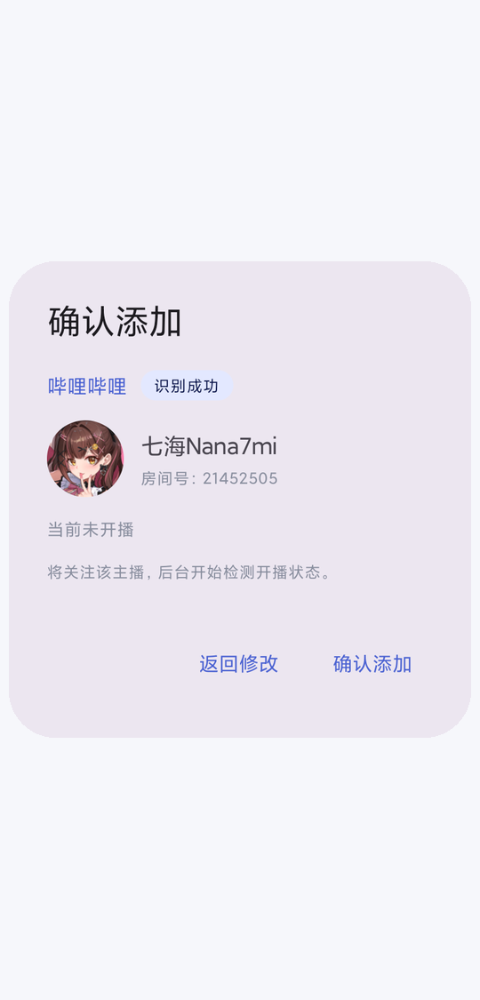
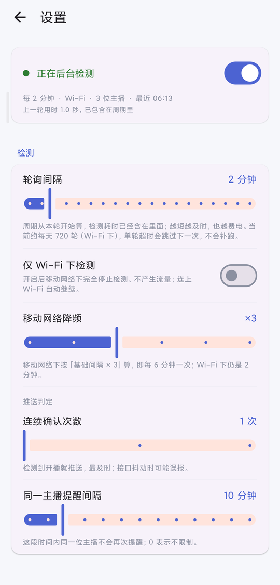
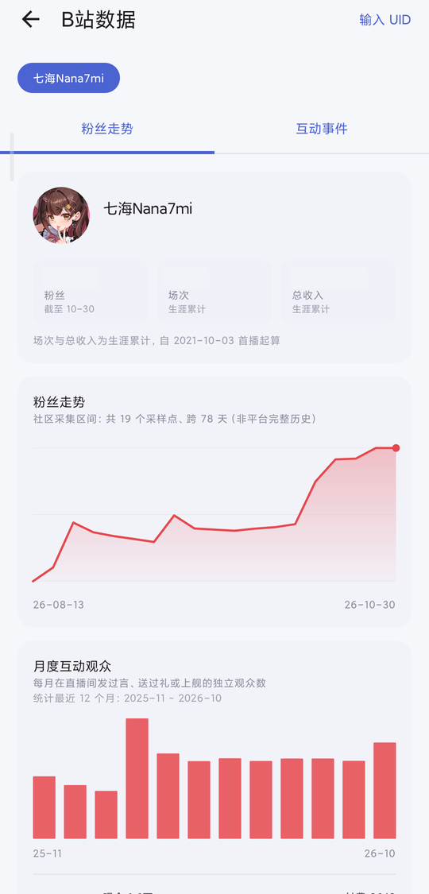
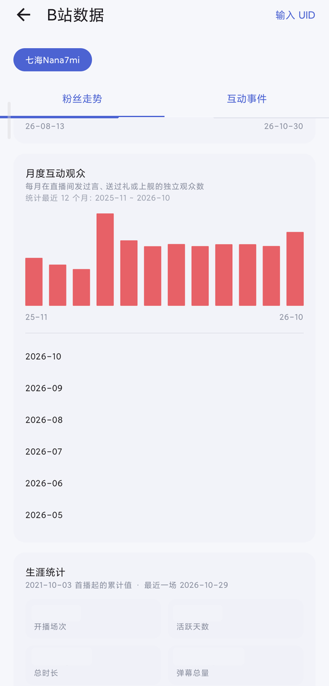
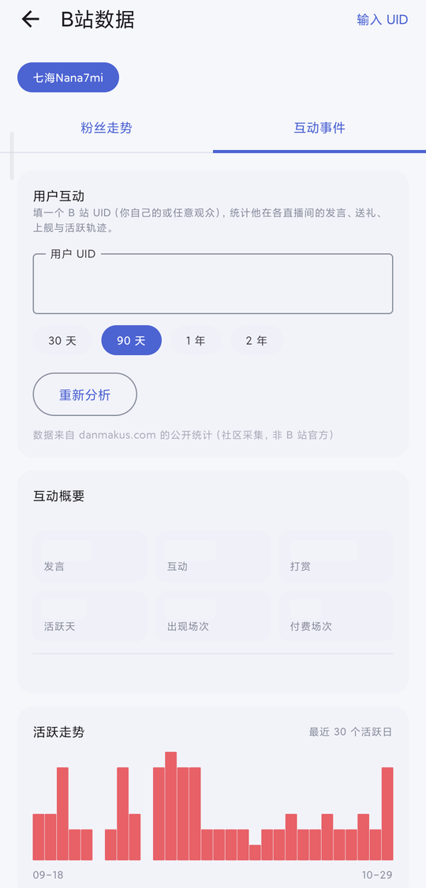

<div align="right">

<a href="README.en.md">English</a> · <b>简体中文</b>

</div>

<p align="center">
  
</p>

<h1 align="center">开播提醒 · LiveNotify</h1>

<p align="center">
  <b>关注的主播开播时，一条通知直达直播间。</b><br />
  开源的 Android 多平台开播提醒应用 · 无账号 · 无服务端 · 无埋点
</p>

<p align="center">
  <a href="https://github.com/xyzOvO/LiveNotify/releases/latest"></a>
  <a href="https://github.com/xyzOvO/LiveNotify/stargazers"></a>
  <a href="https://github.com/xyzOvO/LiveNotify/blob/main/LICENSE"></a>
  
  
  
  
</p>

<p align="center">
  <a href="#download">📲 下载</a> ·
  <a href="#features">✨ 功能</a> ·
  <a href="#ui">🖼 界面</a> ·
  <a href="#platforms">🎯 支持平台</a> ·
  <a href="#build">🛠 构建</a> ·
  <a href="#faq">❓ 常见问题</a> ·
  <a href="#internals">🧩 实现原理</a> ·
  <a href="#bili-stats">📈 B 站数据</a> ·
  <a href="#compliance">⚖️ 合规</a> ·
  <a href="#license">📄 许可证</a>
</p>

<!-- 居中 + 自适应：GitHub 的 markdown-body 对 img 应用 max-width:100%，窄屏自动缩小，不需要内联 style -->
<p align="center">
  
</p>
<p align="center">
  <sub><b>首页（搜索已展开）</b> · 吸顶搜索框 / 筛选 chips / 四平台主播卡片 · 收起搜索后右上角是放大镜入口，详见 <a href="#ui">🖼 界面</a></sub>
</p>

支持 **B站 / 抖音 / 斗鱼 / 虎牙**。前台服务常驻轮询（默认 120 秒），开播推送本地通知，**点通知直达直播间**；记录「上次开播距今」与「已播时长」，多平台状态一眼看完。

还带一个 **B 站数据页**：粉丝走势、月度互动观众、生涯统计，以及任意 UID 的互动分析（发言 / 打赏 / 活跃时段 / 常去直播间）。每个数字都标了统计口径，不拿「生涯累计」冒充「最近一个月」。

> [!WARNING]
> **LiveNotify 永远免费开源。** 如果你是在任何地方「花钱买到」的，说明你被骗了，请立即退款。任何收费版本均为二次打包的诈骗版本，与本项目无关。

> [!NOTE]
> 本项目使用 **MIT 开源协议**，使用代码请保留版权声明；且为 **Android 端个人应用**，与各直播平台无任何隶属、合作或授权关系，代码中的平台名称与图标仅用于标识来源平台，商标归各自权利人所有。App 界面**仅中文**，英文 README 只是文档翻译，不会在应用里加英文界面。

---

<a id="download"></a>

## 📲 下载

> **系统要求**：Android 8.0（API 26）及以上。APK 为正式签名包，首次安装需在系统里允许「安装未知来源应用」。

- **[Releases](https://github.com/xyzOvO/LiveNotify/releases/latest)** 下载 `app-release.apk`（正式签名，装上即用）
- 也可以自行构建（见 [🛠 构建](#build)）

安装后必做的两步，否则可能收不到通知：

1. **允许通知**：Android 13+ 首次启动会弹窗询问；若误拒，去系统设置 → 应用 → 通知 里打开。
2. **放行后台**：设置页关闭「电池优化」，并在系统「自启动 / 后台运行」白名单里放行本应用（MIUI / ColorOS / HarmonyOS 尤其需要）。

添加主播：点右下角 **+**，粘贴直播间链接或房间号，例如
`https://live.bilibili.com/21452505`、`https://live.douyin.com/629458933`、`https://www.douyu.com/71415`、`https://www.huya.com/520520`。

> 手动指定平台时，**纯数字房间号直接可用**（B 站 / 抖音 / 斗鱼 / 虎牙都支持）——不用先去找链接。

---

<a id="features"></a>

## ✨ 功能

### 🔎 检测与调度

| 功能 | 说明 |
|---|---|
| **多平台提醒** | B 站 / 抖音 / 斗鱼 / 虎牙，平台层可插拔，新增平台只需实现一个接口 |
| **固定周期** | 设 120 秒就是「本轮开始 → 下一轮开始」120 秒，检测耗时已算在里面；单轮超时跳过下一次，不连续补跑 |
| **没有网络不硬查** | 网络没通过系统连通性验证时整轮跳过：不发请求、不累计错误、不改开播状态，常驻通知与主页都写「等待网络」；「仅 Wi-Fi」下走流量时写「等待 Wi-Fi」 |
| **防误报三道闸** | 状态跳变 + 连续确认 + 场次去重，网络抖动不会误报开播 |
| **省电省流** | B 站批量接口 20 个主播 1 次请求；移动网络自动降频；可设仅 WiFi 检测；断网时零请求 |
| **状态如实显示** | 服务没在跑、通知权限没开、检测被跳过时，界面与常驻通知直接说明原因，不会假装「一切正常」 |

### 🔔 通知与补发

| 功能 | 说明 |
|---|---|
| **开播通知** | 本地通知点击直达直播间，同一场次不重复推送，带冷却时间 |
| **提醒方式可调** | 开播提醒的响铃 / 震动可分别开关（Android 8+ 走通知渠道） |
| **常驻通知可隐藏** | 后台检测必须保留一条通知，可降到最低可见度，或在系统渠道设置里彻底关闭 |
| **漏提醒会补发** | 通知权限或「开播提醒」渠道被关掉时，这一场不会被记成「已通知」；权限恢复后下一轮自动补上，超过 30 分钟则放弃（免打扰时段主动抑制的提醒根本不入补发队列） |
| **免打扰时段** | 夜间不推送（可选），时段内检测照常但间隔放宽 |

### 📋 关注列表

| 功能 | 说明 |
|---|---|
| **上次开播** | 卡片显示「已播 1 小时 23 分」或「上次开播 5 天前 · 10-23 15:26」 |
| **搜索与筛选** | 按昵称或房间号搜索、按平台筛选、只看直播中；结果实时计数，空结果可一键清除筛选或直接去添加 |
| **点击 / 长按管理** | 卡片本身不跳转，点击或长按都开操作面板：打开直播间 / 复制链接 / B站数据 / 暂停关注 / 移除关注 |
| **系统分享导入** | 在 B站 / 抖音等 App 里分享直播间文案 → 选「开播提醒」，自动预填并识别平台，你点确认才添加 |
| **暂停 / 恢复关注** | 暂停后卡片保留但不检测、不提醒；恢复时先对齐当前场次，不会把正在直播误报成新开播 |
| **关注列表备份** | 导出 / 导入 JSON（本地文件），换机或重装可恢复；不备份 Cookie、直播状态与通知冷却。导入的写库是一次事务：中途失败整批回滚，已有主播的备注与暂停状态不会被覆盖 |
| **纯本地** | 无账号、无服务端、无埋点；数据只在本机 Room 数据库 |

### 📊 数据、更新与可维护性

| 功能 | 说明 |
|---|---|
| **B站数据（粉丝走势）** | 长按 B 站主播 → 粉丝数历史曲线、月度互动观众/付费/上舰趋势、生涯统计（每块都标注统计口径） |
| **B站数据（互动事件）** | 填任一 UID，统计其发言、送礼、上舰、活跃时段与常去直播间 |
| **B站数据有缓存** | 上次成功的数据存在本机：再进页面先看缓存并标注「X 前更新」，过期也会留着；点刷新才重新请求，刷新失败仍显示旧数据 |
| **应用内更新** | 启动时静默检查 GitHub Releases：并排显示当前 / 最新版本与更新日志，下载有进度、失败可原地重试，下载完先校验 SHA-256 再比签名，最后拉起系统安装页 |
| **数据可靠** | 数据库迁移有自动化测试：真实 SQLite 从 v1/v2/v3 分别跑完整条链，逐列对照入库的 schema 快照，暂停状态与通知去重字段逐行核对；发版时 CI 还会校验签名指纹与 versionName/Code 与 tag 一致 |
| **设置页讲清影响** | 按检测 / 通知 / 后台权限 / 数据 / 其他五组分组；顶部直接显示实际间隔、上一轮用时（超时标红）与当前网络，每项都写明改了会怎样 |

---

<a id="ui"></a>

## 🖼 界面

### 🧭 首页速览

封面那张首页截图从上到下是这个结构；**四个平台各一位主播，和截图完全一致，没有更换**：

| 位置 | 区域 | 展示内容 |
|---|---|---|
| 1 | 标题栏 | 「开播提醒」+ 刷新 / 设置两个图标；下面状态行按实时状态显示「监控中 · N / 4 位正在直播」或「监控中 · 4 位都很安静」，圆点随之变绿或变灰 |
| 2 | 检测开关卡 | 「后台检测已开启 / 基础间隔 120 秒 · 上次 刚刚」，一键开关。写「基础间隔」是因为移动网络和免打扰时段会把它拉长；「上次」随最近一轮检测变化 |
| 3 | 列表标题行 | 未展开搜索时是「关注的主播」+「点击或长按管理」+ **右侧放大镜（搜索入口）**；展开后放大镜收起，有筛选时右侧改显示「N / 总位数」 |
| 4 | **搜索栏（点放大镜后）** | 吸顶输入框「搜索昵称 / 房间号 / 短号」+ 清空 / 关闭 +「取消」；下一行横向滚动的筛选 chips：全部平台 / B站 / 抖音 / 斗鱼 / 虎牙 / 只看直播中 |
| 5 | 主播卡片 × 4 | 见下表 |
| 6 | 右下角 **+** | 添加关注；搜索展开时自动收起，免得键盘压住结果 |

> 封面是 2026-11-07 重拍的**搜索展开状态**：四个平台仍各一位主播，昵称与卡片结构未变。拍摄时四位都未开播；直播中会整卡淡红高亮并显示「已播…」。抖音卡片显示接口返回的 `web_rid`（稳定房间标识），与示例链接里的抖音号 `629458933` 指向同一位主播。

| 平台 | 主播 | 房间号（示例链接） | 封面拍摄时 |
|---|---|---|---|
| **哔哩哔哩** | 七海Nana7mi | `21452505` | ⚪ 未开播 |
| **抖音** | 女流66 | `629458933` | ⚪ 未开播 |
| **斗鱼** | 寅子 | `71415` | ⚪ 未开播 |
| **虎牙** | 骚男 | `520520` | ⚪ 未开播 |

每张卡片都显示头像（右下角带平台徽标）、昵称、平台与房间号、直播标题（未开播时是上一场的标题）、开播信息以及状态徽标；直播中时整卡淡红高亮、显示「已播 N 小时 N 分」，未开播时显示「上次开播…」或「暂无开播记录」。

### 👆 交互一览

| 区域 | 操作 | 行为 |
|---|---|---|
| 首页 | 点击 / 长按卡片 | 弹出同一个操作面板，卡片本身不跳直播间，避免误触 |
| 首页 | 下拉列表 / 右上角刷新 | 立即跑一轮检测，刷新按钮同步转圈，检测中禁用重复点击 |
| 首页 | 点「关注的主播」右侧放大镜 | 展开吸顶搜索栏与筛选 chips，输入框自动聚焦 |
| 搜索栏 | 输入昵称 / 房间号 / B 站短号 | 实时过滤，标题行显示「N / 总位数」；滚动列表时自动收起键盘 |
| 搜索栏 | 点输入框右侧 × | 有输入时清空，无输入时直接收起搜索；「取消」与返回键也能退出搜索（返回键只收搜索，不会退出 App） |
| 筛选 chips | 选平台 / 只看直播中 | 可叠加；再点一次同一项取消；窄屏下 chips 单行横向滚动，不占半屏 |
| 空结果 | 「清除筛选」/「添加关注」 | 一键回到完整列表，或直接打开添加弹窗 |
| 操作面板 | 打开直播间 / 复制链接 / 粉丝走势与数据 / 暂停或恢复关注 / 移除关注 | B 站主播才有「粉丝走势与数据」；暂停后卡片保留但不检测 |
| 添加关注 | 右下角 **+** | 粘贴链接 / 房间号 / 整段分享文案，平台可手动指定（自动 / B站 / 抖音 / 斗鱼 / 虎牙） |
| 添加关注 | 「识别主播」→「确认添加」 | **先识别、再确认**：弹窗展示平台、昵称、房间号与识别结果；不满意可「返回修改」，不会自动落库 |
| 系统分享 | 其他 App 分享直播间文案 → 选「开播提醒」 | 自动预填并识别平台，同样要你点确认才添加 |
| 设置页 | 顶部状态卡 | 显示服务是否真的在跑、实际检测间隔、上一轮用时（超时标红）、当前网络、最近一轮检测时间、关注主播数与免打扰状态 |
| 设置页 | 检测 / 通知 / 后台权限 / 数据 / 其他 | 检测：间隔、仅 Wi-Fi、连续确认次数；通知：响铃震动、测试通知、免打扰、隐藏常驻通知、渠道设置；后台权限：自启动、电池优化、通知权限的实际状态与跳转，以及「有 N 条开播提醒待补发」的提示；数据：备份导出导入、B 站数据、抖音 Cookie；其他：检查更新 |
| 设置页 | 返回键 / 侧滑 | 回主页面，不会直接退出 App |
| 其他 · 更新卡片 | 「下载并安装」/「以后再说」 | 设置页内嵌的更新卡片（不是弹窗）：并排显示当前 / 最新版本与完整更新日志，下载带字节进度；「以后再说」记下版本不再打扰，手动检查仍可见 |

卡片头像右下角带平台官方徽标，开播时整卡淡红高亮并呼吸描边，相对时间每 20 秒自动刷新。

<p align="center">
  
  
  
</p>
<p align="center">
  <sub><b>操作面板</b> 点击或长按卡片唤出　·　<b>添加关注</b> 先识别、再确认　·　<b>设置页</b> 真实运行状态与每项设置的实际影响</sub>
</p>

<p align="center">
  
  
  
</p>
<p align="center">
  <sub><b>粉丝走势</b> 概览 / 采样曲线 / 月度观众　·　<b>生涯统计</b> 首播起的累计值　·　<b>互动事件</b> 任意 UID 的行为分析<br/>示例截图中的具体统计数值已脱敏，口径说明保留</sub>
</p>

> 每个统计数字旁边都标了口径：粉丝是「截至某日的快照」，场次与总收入是「生涯累计」，粉丝走势写明「社区采集区间、多少个采样点、跨多少天」——避免把第三方采集到的片段当成完整历史。接口与边界见 [📈 B 站数据](#bili-stats)。

---

<a id="platforms"></a>

## 🎯 支持平台

| 平台 | 接口 | 批量 | 开播时间 |
|---|---|---|---|
| **B 站** | 官方公开接口 `get_status_info_by_uids` | ✅ 一次 20 个 | 未开播时接口不返回，需本地观测累积 |
| **抖音** | webcast 移动端落地页解析（`status=2` 为直播中） | ❌ 逐个请求，节流 1.5s | ✅ 页面直接返回 `createTime` |
| **斗鱼** | `open.douyucdn.cn/api/RoomApi/room/{rid}` | ❌ 节流 1.2s | ✅ 接口直接返回 `start_time`，刚添加就能看到上次开播 |
| **虎牙** | `mp.huya.com/cache.php?m=Live&do=profileRoom` | ❌ 节流 1s | ❌ 接口不返回，只能本地观测 |

> 抖音官方未开放个人可用的直播间状态接口，这里读的是 `webcast.amemv.com` 的移动端落地页（免登录、免签名，约 90KB/次）。
> 属未经官方授权的网页解析，页面改版可能失效；设置页可粘贴浏览器 Cookie 提升成功率（仅存本机）。
> 分享文案里的 `v.douyin.com` 短链会自动跟随跳转到该落地页，直接粘贴整段文案即可。

---

<a id="build"></a>

## 🛠 构建

**环境要求**：JDK 17、Android SDK（`compileSdk 35` / `minSdk 26`）、Gradle 8.9（Wrapper 已随仓库提供）。

> ⚠️ 项目请放在**纯英文路径**下（如 `D:\LiveNotify`）。AGP 在 Windows 上会拒绝含中文的目录（`Your project path contains non-ASCII characters`）。仓库里的 `android.overridePathCheck=true` 只是兜底，底层工具仍可能出问题。

### 💻 命令行

```bash
./gradlew assembleDebug      # macOS / Linux
gradlew.bat assembleDebug    # Windows
# 产物：app/build/outputs/apk/debug/app-debug.apk
```

> 国内网络下载 Gradle 分发慢的话，把 `gradle/wrapper/gradle-wrapper.properties` 的 `distributionUrl` 换成
> `https://mirrors.cloud.tencent.com/gradle/gradle-8.9-bin.zip` 即可。

### 🧰 Android Studio

`File → Open` 选项目根目录 → 等 `Sync Now` → 连真机点 Run。

### 🔑 签名（可选）

**本地构建**：没有 `keystore.properties` 时用 debug 签名，任何人克隆后都能构建出可安装的 APK。要用自己的签名：

```bash
keytool -genkeypair -v -keystore keystore/livenotify.jks -alias livenotify \
        -keyalg RSA -keysize 2048 -validity 10950
```

然后在项目根目录建 `keystore.properties`（该文件与 `keystore/` 目录均已在 `.gitignore` 中，不会误传）：

```properties
storeFile=keystore/livenotify.jks
storePassword=你的密码
keyAlias=livenotify
keyPassword=你的密码
```

存在该文件即自动切换为正式签名。想给 CI 也配上同一把密钥，把 `.jks` 编码成 base64 存进仓库 Secrets：

| Secret | 值 |
|---|---|
| `KEYSTORE_BASE64` | `keystore/livenotify.jks` 的 base64（`base64 -w0` 或 PowerShell `[Convert]::ToBase64String(...)`） |
| `KEYSTORE_PASSWORD` | `storePassword` |
| `KEY_ALIAS` | `livenotify` |
| `KEY_PASSWORD` | `keyPassword` |

> [!IMPORTANT]
> **正式发布不允许签名降级。** 本地 Debug 构建不受影响；但由 tag 触发的发布工作流会**强制**要求四个 Secret 齐全，缺任何一项直接失败、不产出可发布 APK。打包后还会逐字比对签名 SHA-256 指纹，并校验 `versionName` / `versionCode` 与 tag 一致、且高于上一版——保证连续版本可以直接覆盖安装。换密钥等于全体旧用户不能覆盖升级，必须同步更新工作流里的指纹并在 Release 里公告。

---

<a id="faq"></a>

## ❓ 常见问题

**Q：重启手机后不检测了？**
国产 ROM 默认禁止第三方应用自启动，开机广播根本不会发给 App（应用侧无法绕过）。去设置页「后台权限」→「自启动」把本应用加进白名单，并把省电策略设为「无限制」。另一种情况是被系统的「强行停止」点过——那之后所有广播都不再送达，必须手动打开一次 App 才恢复。

**Q：通知栏一直有一条「正在检测」的通知，能关掉吗？**
这是 Android 对前台服务的合规要求，应用内无法彻底移除。两条路：设置页打开「隐藏常驻通知」把它降到最低可见度（静音、不弹窗、不显示角标）；或点设置页的「常驻通知设置」进系统渠道页，把「后台检测」渠道整个关掉——检测照常运行。

**Q：后台过一会儿就被杀了？**
这是厂商 ROM 的限制，不是应用 bug。去系统设置放行「自启动 / 电池优化 / 后台运行」。

**Q：搜索框怎么退出？筛选会不会把主播弄丢？**
点「取消」、点输入框右侧的 ×（有内容时先清空，再点一次收起）、或按返回键都可以；返回键只收搜索，不会退出 App。筛选**只作用于当前界面**：后台检测、常驻通知用的始终是完整关注列表，暂停状态和直播状态都不会因为筛选而改变。

**Q：搜不到某个主播？**
搜索匹配昵称、房间号与 B 站短号（`short_id`，卡片上以「短号 N」附注显示），可以只输一段；再检查是不是叠加了平台 chips 或「只看直播中」。空结果页有「清除筛选」一键回全量，也有「添加关注」直接去添加。

**Q：应用内更新提示「签名不一致」？**
更新包必须与当前安装的版本同签名才能覆盖安装。如果你之前装的是 debug 签名包（早期 CI 产物），换正式签名包必须先卸载一次；之后同一签名的版本都能直接覆盖升级，关注列表不会丢。应用会在提示里直接给出原因和唯一的出路——先去设置页导出一份关注列表备份，再卸载重装、导入备份。

**Q：更新日志为什么有时是空的？**
更新说明优先取 GitHub API；`api.github.com` 在部分网络（共享出口 IP、被限流）会返回 403，此时改走 Releases 页兜底：更新日志从 `releases.atom` 补回，版本号与下载地址来自 `/releases/latest` 的 302 重定向。两条路都不通时只显示「暂无更新说明」，不影响下载与安装。

**Q：点过「以后再说」还会提醒吗？**
不会。该版本会被记下来，之后启动时自动检查到这个版本不再打扰；出了更新的版本才会重新提示。手动点「检查更新」仍然能看到，随时可以改主意。

**Q：应用内更新为什么要校验 SHA-256？**
GitHub Releases 的附件自带 `digest`（`sha256:<hex>`），下载完成后先算一遍文件 hash，不一致就删掉重下并提示「安装包校验未通过」。签名比对回答「是不是同一作者发的」，文件 hash 回答「这一份有没有下全」，两者互补。走 Releases 页 302 兜底拿不到 digest 时会跳过文件校验，但安装前的签名比对仍照常生效。

**Q：为什么「上次开播」是空的？**
只有接口直接返回开播时刻的平台（斗鱼、抖音）能立刻显示；B 站 / 虎牙需要 App 先观测到一次开播才能累积出来。

**Q：抖音一直提示「页面结构可能已变更」？**
抖音改版了。先在浏览器用移动端 UA 打开 `https://webcast.amemv.com/douyin/webcast/reflow/<房间号>` 看还能不能拿到数据；也可以在设置页填 Cookie 提升成功率。

**Q：抖音分享文案粘贴进去读不出来？**
正常能读。`v.douyin.com` 短链会跟随跳转到真实房间地址，房间号就在跳转后的 `reflow/<数字>` 里。若仍失败，多是直播已结束或短链过期，重新在抖音里分享一次即可。

**Q：检测延迟有多大？**
默认 120 秒一轮，周期是「本轮开始到下一轮开始」，检测本身的耗时已经算在里面——不会出现「设 2 分钟、实际 2 分半」。如果某一轮因为网络慢超过了一个周期，错过的轮次直接跳过，不会连着重跑。

**Q：两轮之间隔得比设置的久？**
先看设置页状态卡的「上一轮用时」。超过设定周期时它会标红——那时确实会少跑一轮。常见原因是抖音逐个数主播加上弱网，把一轮拖到了周期以上。把间隔调大一点或减少关注数量即可。

**Q：没网的时候还在不停请求吗？**
不会。网络没有通过系统连通性验证（没连上、连上了但没有出口、强制门户 Wi-Fi）时整轮直接跳过：一次请求都不发，也不累计主播的错误次数；常驻通知、主页状态行与设置页写「等待网络」，恢复后自动继续，不用等下一轮才改口。

**Q：怎么减少耗电？**
设置页开启「仅 WiFi 检测」、把间隔调大、免打扰时段设为夜间。

**Q：开播时我把通知关了，后来再打开还能收到吗？**
能，只要这场还没播太久。发不出去的通知不会被记成「已通知」，而是留一条待补发记录：设置页会写「有 N 条开播提醒因为通知被关掉没能送达」，权限恢复后下一轮检测自动补上。补发时通知标题是「正在直播」并注明「已开播约 N 分钟」，不会假装刚开播。超过 **30 分钟**就放弃——那时再弹「开播了」更像打扰。免打扰时段主动抑制的提醒不在此列，安静时段结束后不会突然补发。

---

<a id="internals"></a>

## 🧩 实现原理与取舍

### 🤔 为什么是 Android 原生

| 方案 | 优点 | 为什么不选 |
|---|---|---|
| **Android 原生（本项目）** | 前台服务、通知渠道、Doze/电池优化行为可控；功耗可精细调优 | 只覆盖 Android，iOS 需另写一套 |
| Flutter / RN | 一套代码双端 | 1~3 分钟轮询依赖原生前台服务，跨平台层最终仍要写原生插件；后台保活、厂商 ROM 适配反而更难调试 |

**若必须覆盖 iOS，再单独做 iOS 原生或用 Flutter 重写；仅 Android 场景，原生是坑最少的方案。**

### ⏱ 为什么用前台服务而不是 WorkManager

`PeriodicWorkRequest` 最小周期 **15 分钟**，且受 Doze 影响实际执行更晚，**无法实现 1~3 分钟轮询**。因此检测循环跑在 `MonitorService`（`foregroundServiceType="specialUse"`）里：固定周期调度——记下本轮开始时刻，跑完后等到「开始时刻 + 周期」再跑下一轮，单轮超时就跳到下一个格点，不补跑。若你能接受 15 分钟以上间隔，把调度换成 `PeriodicWorkRequest` 即可省掉常驻通知——引擎 `MonitorEngine.runOnce()` 是纯挂起函数，两种调度可直接替换。

类型选 `specialUse` 而不是 `dataSync`：Android 15 给 `dataSync` 加了「24 小时累计最多运行 6 小时」的硬限制，到点系统静默停掉服务；开播提醒需要全天候运行，只能走 `specialUse`（并在清单里写明用途）。

### 🗂 项目结构

```
app/
├── schemas/                  Room 每个版本的表结构快照（迁移测试的比对基准）
└── src/main/java/com/example/livenotify/
    ├── LiveNotifyApp.kt      Application：初始化依赖图、建通知渠道、按需拉起服务
    ├── Graph.kt              极简手工依赖图（无 Hilt）
    ├── data/
    │   ├── StreamerEntity.kt Room 实体（含去重/防抖/待补发所需字段）
    │   ├── StreamerDao.kt    DAO（Flow 观察 + 批量更新）
    │   ├── AppDatabase.kt    Room 数据库单例（v1→v4 增量迁移，MIGRATION_SQL 单一来源）
    │   └── SettingsRepository.kt DataStore 设置项
    ├── platform/
    │   ├── LivePlatform.kt   ★ 平台抽象（新增平台只需实现此接口 + 注册）
    │   ├── BilibiliPlatform.kt  B 站：批量官方接口
    │   ├── DouyinPlatform.kt    抖音：webcast 移动端落地页降级方案
    │   ├── DouyuPlatform.kt     斗鱼：room_status / start_time 解析
    │   ├── HuyaPlatform.kt      虎牙：liveStatus + realLiveStatus 交叉校验
    │   └── DouyinParser.kt      抖音落地页解析（锚定 room 对象）+ 风控识别
    ├── net/Http.kt           OkHttp 封装 + 按 host 节流器
    ├── bili/                 B 站数据：第三方统计接口 + 手写 MessagePack 解码
    │   ├── BiliStatsApi.kt   五个统计端点集中于此
    │   ├── StatsEndpoint.kt  线路选择（主/备用域、按上次成功域排序、文档地址）
    │   ├── StatsCache.kt     本地缓存：优先读缓存、手动刷新才请求
    │   └── MsgPack.kt        手写 MessagePack 解码器（免引入依赖）
    ├── update/               应用内更新
    │   ├── UpdateApi.kt      查 GitHub Releases、解析版本与 APK 下载地址
    │   ├── ReleaseNotes.kt   Release 正文去 Markdown 噪声，小屏可读
    │   ├── ReleasesAtom.kt   API 被 403 时用 releases.atom 补回更新日志
    │   ├── ApkHash.kt        文件 SHA-256 校验（解析 asset 的 digest）
    │   ├── ApkDownloader.kt  流式下载（带字节进度）+ 复用旧包 + 下载后校验
    │   └── ApkInstaller.kt   包名/签名/版本自检 + FileProvider 拉起系统安装页
    ├── monitor/
    │   ├── MonitorEngine.kt  ★ 检测引擎：批量拉取 → 状态对比 → 去重 → 推送 → 落库
    │   ├── PollSchedule.kt   周期与间隔的唯一算法（固定周期、移动网络倍数、免打扰降频）
    │   ├── NetworkState.kt   网络可用性（VPN 只看底层网络，两个方向的误判都有单测）
    │   ├── MonitorService.kt 前台服务轮询循环（specialUse 类型，划掉任务后自恢复）
    │   ├── NotificationHelper.kt 通知渠道与开播通知（点击跳直播间）
    │   ├── PendingNotify.kt  通知没发出去时的待补发判据（同场次、有效期、放弃）
    │   └── BootReceiver.kt   开机自启（受 ROM 限制，失败静默）
    └── ui/                   Compose 界面（主列表与搜索 / 添加 / 设置 / 数据 / 更新）
```

**新增一个平台（例如快手）**：实现 `LivePlatform`（`accept` 识别输入、`resolve` 解析出稳定标识、`fetch` 批量查询）→ 在 `PlatformRegistry.platforms` 加一行 → UI、数据库、检测引擎**零改动**。

### 🛡 检测引擎与防误报三道闸

一轮流程：读取启用列表 → 按平台分组 → 调 `platform.fetch()` → 逐个处理 → 批量落库。整轮用 `Mutex` 串行化，避免后台轮询与手动刷新并发导致重复推送。

1. **状态跳变**：必须「上次未开播 → 本次开播」才可能推送；
2. **连续确认**：连续 N 次检测到开播才推（默认 1，可调 2~3）；**未达次数前 `isLive` 仍记 false**，否则第二轮会被「上次已开播」挡住，导致 2~3 次确认时永远不推送；
3. **场次去重 + 冷却**：`lastNotifiedLiveStart` 记录已推送场次，同场次不再推，外加冷却（默认 10 分钟）。

### 🚧 边界情况

| 情况 | 处理 |
|---|---|
| 网络异常 / 超时 | **不改动已知状态**（不把「没查到」当成「没开播」），只累计错误次数，连续 3 次以上列表标红 |
| 整轮无有效网络 | 不发起任何请求、不累计错误、不改开播状态，界面与常驻通知写「等待网络 / 等待 Wi-Fi」 |
| 平台接口变更 / 解析失败 | 标记为不可重试错误并提示；抖音会明确显示「抖音页面结构可能已变更」 |
| 抖音房间号失效 / 已下播 | 落地页退化成空壳，保守按「未开播」处理——宁可漏报也不误报开播 |
| B 站限流（code -412 / -509） | 判定为可重试，节流器保证最小请求间隔 |
| 主播改名 / 换头像 | 每轮把昵称、头像、标题、房间链接回写数据库 |
| 主播注销 / 房间删除 | 标记失效，列表显示「失效」，不再推送，保留条目等用户移除 |
| 添加时已开播 | 入库记为已开播但**不立即推送**，等下一场开播才提醒 |
| 重复添加 | 唯一索引 `(platformId, anchorId)` 拦截 |
| 开播超过 20 小时（多见于斗鱼重播房） | 斗鱼的 `room_status` 仍为 1 但 `start_time` 是几周前；此时**所有平台**都只显示「直播中」，不再显示「已播 N 小时」 |
| 界面正在搜索 / 筛选 | 只影响当前列表的可见项；检测引擎与常驻通知始终读完整列表 |

### 🕒 上次开播：数据从哪来

| 状态 | 展示 | 数据来源 |
|---|---|---|
| 正在直播 | `已播 1 小时 23 分 · 15:26 开播` | `liveStartAt`（本场开播时刻） |
| 未开播、有记录 | `上次开播 5 天前 · 10-23 15:26` | `lastLiveStartAt`（上一场，永久保留） |
| 未开播、无记录 | `暂无开播记录` | — |

`lastLiveEndAt` 记录引擎检测到「开播 → 未开播」跳变时的下播时刻。数据库 v1→v4 全程用 `ALTER TABLE ADD COLUMN` 增量迁移，升级不丢关注列表；迁移链由 `MigrationSqlTest` 用真实 SQLite 从 v1/v2/v3 三个起点逐列校验。

### 🔋 省电与省流量

- **B 站批量接口**：20 个主播 1 次请求，而不是 20 次；
- 节流器：B 站 800ms/次、抖音 1500ms/次；
- 移动网络下间隔自动 ×3（可调 1~6），免打扰时段再 ×5；可设「仅 WiFi 检测」（按 `TRANSPORT_WIFI` 判断，不用「是否计费」代替网络类型）；
- OkHttp 连接池复用（3 连接 / 5 分钟）；异常时 30 秒退避重试。

---

<a id="verification"></a>

## 📊 实测验证记录（2026-11-07）

| 项目 | 结果 |
|---|---|
| **数据库迁移 v1→v4 自动化** | ✅ 真实 SQLite 从三个起点跑通迁移链，逐列对照 schema 快照；全量单测 133 项通过、lint 0 error |
| **多平台一轮检测** | ✅ 4 位主播跨 4 平台：`checked=4 notified=0 err=0` |
| **搜索 / 筛选 / 设置页返回** | ✅ 真机验证：操作面板、立即检测、搜索与筛选、返回键收搜索、侧滑回主页面均正常 |
| **通知补发 / 应用内更新** | ✅ 真机：关权限后恢复自动补发；v1.0.5 → v1.0.6 未卸载覆盖升级，数据保留 |
| **发布签名校验** | ✅ CI 逐字比对 SHA-256 指纹；`versionCode=10011` / `versionName=1.0.11` 与 tag 一致 |

---

<a id="bili-stats"></a>

## 📈 B 站数据（可选功能）

长按一个 B 站主播 → 「粉丝走势与数据」，或从设置页进入。两块内容：

**粉丝走势**：粉丝总数历史曲线、月度互动观众 / 新观众 / 回访 / 付费人数 / 上舰数 / 打赏金额、生涯统计（场次、活跃天数、总时长、弹幕总量、总收入）。

**互动事件**：输入任意 B 站 UID，统计该用户在各直播间的发言量、打赏、活跃天数、事件类型分布、常去直播间排行、周×小时活跃热力、常用词。另附**最近的互动**清单——逐条列出该用户最近的弹幕 / 礼物 / 上舰 / 醒目留言，按时间倒序（最近在前），每条标出发生时间与所在直播间。

数据鸣谢 [danmakus.com](https://danmakus.com/)：本页数据来自社区客户端采集并开放的公开统计接口，**数据覆盖取决于社区采集范围**，不是 B 站官方数据，也不需要登录任何账号。App 内「互动事件」页也标注了来源，接口文档见 [/swagger/index.html](https://ukamnads.icu/swagger/index.html)。

| 用途 | 接口 |
|---|---|
| 主播信息 + 粉丝历史 | `GET /api/v2/channel?uId=` |
| 月度观众趋势 | `GET /api/v2/channel/audience-trend?uId=` |
| 生涯统计 | `GET /api/v2/wiki/channel/{uid}/career` |
| 用户互动分析 | `POST /api/v3/user-analysis-jobs` → 轮询 → `/result`（MessagePack） |
| 最近的互动（逐条记录） | `GET /api/v3/users/{userId}/history`（按场次返回该用户的弹幕/打赏记录） |

几个必须说清的点：

- **每个数字都标了口径**：粉丝数为最新快照（标「截至 MM-dd」）；场次、总收入、总时长、弹幕总量都是**生涯累计**，从 `career` 接口给出的首播日算起；粉丝走势标的是**当前采集区间**（通常两三个月、十几个采样点），数据覆盖取决于社区采集范围；月度观众固定取最近 12 个月；互动分析标注实际提交的时间区间。
- 请求只带 uid，不发本机关注列表，也不带任何登录态。
- 分析任务是服务端重查询，因此**只在手动点「开始分析」时才发起**；主播数据与已成功的结果会落本机缓存，再进页面优先显示缓存并标注更新时间，刷新失败也保留旧数据。
- **接口线路自动容灾**：主节点 `ukamnads.icu` 与镜像 `api.ukamnads.icu` 返回同一份数据；网络异常 / 5xx / 429 时自动换域重试一次，成功后记住该线路（存本机设置），页脚显示「当前线路」。4xx 与业务错误不换域——换多少个节点结果都一样。全部失败时明确提示「数据服务暂不可用，开播提醒不受影响」。
- 没有采集到数据时给解释性空态，不画一张空图；服务端结构可能随时变更，接口路径集中在 `bili/BiliStatsApi.kt`，域名集中在 `bili/StatsEndpoint.kt`。
- 这些接口对同一 IP 有频率限制，密集查询可能返回空数据或失败，界面会给中文提示。
- 不想要这个功能可以完全不用——它不参与开播检测，也不影响任何本地数据。

---

<a id="compliance"></a>

## ⚖️ 合规与风险提示

1. 本项目仅用于**个人关注主播的开播提醒**，数据来自各平台公开页面 / 公开接口，不做存储转发、不分发、不用于商业分析。
2. 抖音链路属**未经官方授权的网页解析**：请自行控制请求频率（默认已节流）、不要用于批量采集；页面改版会导致失效，届时应停用该链路或改用官方渠道申请企业资质。
3. 抖音 Cookie 为**可选**功能，仅保存在本机 DataStore，不会上传；应用已设 `allowBackup=false`（不进系统/云备份），设置页默认遮蔽显示。
4. 通知小图标为单色 PNG；若你的 ROM 上显示异常，替换 `drawable-*/ic_notification.png` 即可，无需改代码。
5. **商标与图标**：`drawable-*/ic_platform_*.png` 为各平台官方图标，商标权归对应公司所有，本项目不主张任何权利。若你是相关权利人并认为使用不当，请提 issue，我会第一时间移除。商业化分发请自行替换为中性图标。

---

<a id="license"></a>

## 📄 许可证

[MIT](LICENSE) © 2026 gjkt

---

<a id="credits"></a>

## 🙏 参考

- 问题反馈与建议：[GitHub Issues](https://github.com/xyzOvO/LiveNotify/issues)
- 更新日志与历史版本：[Releases](https://github.com/xyzOvO/LiveNotify/releases)
- B 站数据页的统计来自 [danmakus.com](https://danmakus.com/) 社区采集；各平台公开接口由其自行维护，本项目仅作调用。
- 头像、图标等资源版权归原作者所有。
