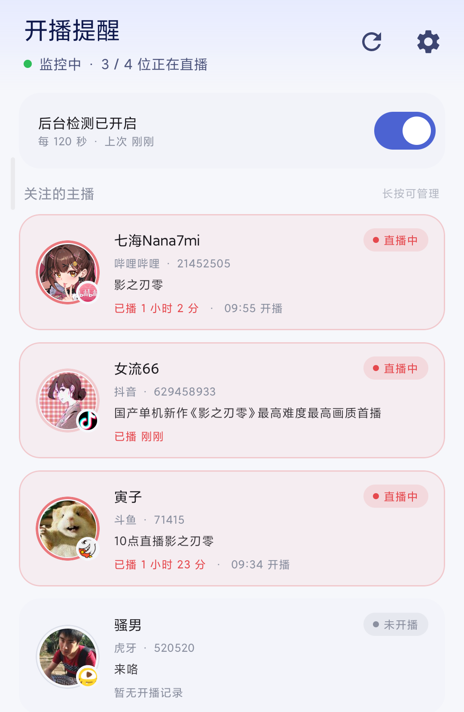

# 开播提醒 · LiveNotify

**关注的主播开播时，一条通知直达直播间 —— 一个开源的 Android 多平台开播提醒应用**

支持 **B 站 / 抖音 / 斗鱼 / 虎牙**。前台服务常驻轮询（默认 120 秒），开播推送本地通知，点击直接跳转直播间；记录「上次开播距今」与「已播时长」，多平台状态一眼看完。

      

[下载](#-下载) · [功能](#-功能) · [支持平台](#-支持平台) · [界面](#-界面) · [构建](#-构建) · [常见问题](#-常见问题) · [实现原理](#-实现原理与取舍)

<p align="center">
  
</p>

> **LiveNotify 永远免费开源。** 如果你是在任何地方「花钱买到」的，说明你被骗了，请立即退款。任何收费版本均为二次打包的诈骗版本，与本项目无关。

> **LiveNotify 使用 MIT 开源协议。** 如果你使用了本项目的代码，请遵守协议保留版权声明。

> 本项目为 **Android 端 App**，与各直播平台无任何隶属、合作或授权关系；代码中的平台名称与图标仅用于标识来源平台，商标归各自权利人所有。

---

## 📲 下载

- **[Releases](https://github.com/xyzOvO/LiveNotify/releases/latest)** 下载 `app-release.apk`（已签名，装上即用）
- 也可以自行构建（见 [🛠 构建](#-构建)）

安装后必做的两步，否则可能收不到通知：

1. **允许通知**：Android 13+ 首次启动会弹窗询问；若误拒，去系统设置 → 应用 → 通知 里打开。
2. **放行后台**：设置页关闭「电池优化」，并在系统「自启动 / 后台运行」白名单里放行本应用（MIUI / ColorOS / HarmonyOS 尤其需要）。

添加主播：点右下角 **+**，粘贴直播间链接或房间号，例如
`https://live.bilibili.com/21452505`、`https://live.douyin.com/629458933`、`https://www.douyu.com/71415`、`https://www.huya.com/520520`。

> 手动指定平台时，**纯数字房间号直接可用**（B 站 / 抖音 / 斗鱼 / 虎牙都支持）——不用先去找链接。

---

## ✨ 功能

| 功能 | 说明 |
|---|---|
| **多平台提醒** | B 站 / 抖音 / 斗鱼 / 虎牙，平台层可插拔，新增平台只需实现一个接口 |
| **开播通知** | 本地通知点击直达直播间，同一场次不重复推送，带冷却时间 |
| **提醒方式可调** | 开播提醒的响铃 / 震动可分别开关（Android 8+ 走通知渠道） |
| **常驻通知可隐藏** | 后台检测必须保留一条通知，可降到最低可见度，或在系统渠道设置里彻底关闭 |
| **上次开播** | 卡片显示「已播 1 小时 23 分」或「上次开播 5 天前 · 10-23 15:26」 |
| **防误报三道闸** | 状态跳变 + 连续确认 + 场次去重，网络抖动不会误报开播 |
| **省电省流** | B 站批量接口 20 个主播 1 次请求；移动网络自动降频；可设仅 WiFi 检测 |
| **免打扰时段** | 夜间不推送（可选），时段内检测照常 |
| **手动检测** | 右上角刷新或下拉列表立即跑一轮 |
| **长按管理** | 长按卡片：打开直播间 / 复制链接 / 移除关注 |
| **应用内更新** | 启动时静默检查 GitHub Releases，有新版直接弹窗，下载完拉起系统安装页，无需卸载重装 |
| **纯本地** | 无账号、无服务端、无埋点；数据只在本机 Room 数据库 |

---

## 🎯 支持平台

| 平台 | 接口 | 批量 | 开播时间 |
|---|---|---|---|
| **B 站** | 官方公开接口 `get_status_info_by_uids` | ✅ 一次 20 个 | 未开播时接口不返回，需本地观测累积 |
| **抖音** | webcast 移动端落地页解析（`status=2` 为直播中） | ❌ 逐个请求，节流 1.5s | ✅ 页面直接返回 `createTime` |
| **斗鱼** | `open.douyucdn.cn/api/RoomApi/room/{rid}` | ❌ 节流 1.2s | ✅ 接口直接返回 `start_time`，刚添加就能看到上次开播 |
| **虎牙** | `mp.huya.com/cache.php?m=Live&do=profileRoom` | ❌ 节流 1s | ❌ 接口不返回，只能本地观测 |

> 抖音官方未开放个人可用的直播间状态接口，这里读的是 `webcast.amemv.com` 的移动端落地页（免登录、免签名，约 90KB/次）。
> 属未经官方授权的网页解析，页面改版可能失效；设置页可粘贴浏览器 Cookie 提升成功率（仅存本机）。
> 分享文案里的 `v.douyin.com` 短链会自动跟随跳转到该落地页，直接粘贴整段文案即可。

---

## 🖼 界面

| 操作 | 行为 |
|---|---|
| 点击卡片 | 打开直播间（浏览器 / 对应 App） |
| **长按卡片** | 弹出操作面板：打开直播间 / 复制直播间链接 / 移除关注 |
| 下拉列表 | 立即跑一轮检测，标题栏刷新按钮同步转圈 |
| 右上角刷新图标 | 同「立即检测」，检测中禁用重复点击 |
| 右下角「添加关注」 | 粘贴链接或房间号，平台可手动指定（自动 / B站 / 抖音 / 斗鱼 / 虎牙） |

卡片头像右下角带平台官方徽标，开播时整卡淡红高亮并呼吸描边，相对时间每 20 秒自动刷新。

---

## 🛠 构建

**环境要求**：JDK 17、Android SDK（`compileSdk 35` / `minSdk 26`）、Gradle 8.9（Wrapper 已随仓库提供）。

> ⚠️ 项目请放在**纯英文路径**下（如 `D:\LiveNotify`）。AGP 在 Windows 上会拒绝含中文的目录（`Your project path contains non-ASCII characters`）。仓库里的 `android.overridePathCheck=true` 只是兜底，底层工具仍可能出问题。

### 命令行

```bash
./gradlew assembleDebug      # macOS / Linux
gradlew.bat assembleDebug    # Windows
# 产物：app/build/outputs/apk/debug/app-debug.apk
```

> 国内网络下载 Gradle 分发慢的话，把 `gradle/wrapper/gradle-wrapper.properties` 的 `distributionUrl` 换成
> `https://mirrors.cloud.tencent.com/gradle/gradle-8.9-bin.zip` 即可。

### Android Studio

`File → Open` 选项目根目录 → 等 `Sync Now` → 连真机点 Run。

### 签名（可选）

Release 包默认用 debug 签名，**任何人克隆后都能构建出可安装的 APK**。要用自己的签名：

```bash
keytool -genkeypair -v -keystore keystore/livenotify.jks -alias livenotify \
        -keyalg RSA -keysize 2048 -validity 10950
```

然后在项目根目录建 `keystore.properties`（该文件与 `keystore/` 目录均已在 `.gitignore` 中，不会误传）：

```properties
storeFile=keystore/livenotify.jks
storePassword=你的密码
keyAlias=livenotify
keyPassword=你的密码
```

存在该文件即自动切换为正式签名。

应用内更新要求前后版本签名一致。想给 CI 也配上同一把密钥，把 `.jks` 编码成 base64 存进仓库 Secrets：

| Secret | 值 |
|---|---|
| `KEYSTORE_BASE64` | `keystore/livenotify.jks` 的 base64（`base64 -w0` 或 PowerShell `[Convert]::ToBase64String(...)`） |
| `KEYSTORE_PASSWORD` | `storePassword` |
| `KEY_ALIAS` | `livenotify` |
| `KEY_PASSWORD` | `keyPassword` |

四项齐全时 CI 出正式签名包；缺任何一项则回退 debug 签名（能装，但与正式签名包不互通）。

---

## ❓ 常见问题

**Q：重启手机后不检测了？**
国产 ROM 默认禁止第三方应用自启动，开机广播根本不会发给 App（应用侧无法绕过）。去设置页「后台运行」→「自启动管理」把本应用加进白名单，并把省电策略设为「无限制」。另一种情况是被系统的「强行停止」点过——那之后所有广播都不再送达，必须手动打开一次 App 才恢复。

**Q：通知栏一直有一条「正在检测」的通知，能关掉吗？**
这是 Android 对前台服务的合规要求，应用内无法彻底移除。两条路：设置页打开「隐藏常驻通知」把它降到最低可见度（静音、不弹窗、不显示角标）；或点设置页的「常驻通知设置」进系统渠道页，把「后台检测」渠道整个关掉——检测照常运行。

**Q：后台过一会儿就被杀了？**
这是厂商 ROM 的限制，不是应用 bug。去系统设置放行「自启动 / 电池优化 / 后台运行」。

**Q：应用内更新提示「签名不一致」？**
更新包必须与当前安装的版本同签名才能覆盖安装。如果你之前装的是 debug 签名包（早期 CI 产物），换正式签名包必须先卸载一次；之后同一签名的版本都能直接覆盖升级，关注列表不会丢。

**Q：为什么「上次开播」是空的？**
只有接口直接返回开播时刻的平台（斗鱼、抖音）能立刻显示；B 站 / 虎牙需要 App 先观测到一次开播才能累积出来。

**Q：抖音一直提示「页面结构可能已变更」？**
抖音改版了。先在浏览器用移动端 UA 打开 `https://webcast.amemv.com/douyin/webcast/reflow/<房间号>` 看还能不能拿到数据；也可以在设置页填 Cookie 提升成功率。

**Q：抖音分享文案粘贴进去读不出来？**
正常能读。`v.douyin.com` 短链会跟随跳转到真实房间地址，房间号就在跳转后的 `reflow/<数字>` 里。若仍失败，多是直播已结束或短链过期，重新在抖音里分享一次即可。

**Q：检测延迟有多大？**
默认 120 秒一轮，误差即一个周期。要更快可调小间隔，但要考虑耗电与平台限流。

**Q：怎么减少耗电？**
设置页开启「仅 WiFi 检测」、把间隔调大、免打扰时段设为夜间。

---

## 🧩 实现原理与取舍

### 为什么是 Android 原生

| 方案 | 优点 | 为什么不选 |
|---|---|---|
| **Android 原生（本项目）** | 前台服务、通知渠道、Doze/电池优化行为可控；功耗可精细调优 | 只覆盖 Android，iOS 需另写一套 |
| Flutter / RN | 一套代码双端 | 1~3 分钟轮询依赖原生前台服务，跨平台层最终仍要写原生插件；后台保活、厂商 ROM 适配反而更难调试 |

**若必须覆盖 iOS，再单独做 iOS 原生或用 Flutter 重写；仅 Android 场景，原生是坑最少的方案。**

### 为什么用前台服务而不是 WorkManager

`PeriodicWorkRequest` 最小周期 **15 分钟**，且受 Doze 影响实际执行更晚，**无法实现 1~3 分钟轮询**。因此检测循环跑在 `MonitorService`（`foregroundServiceType="specialUse"`）里：`while(isActive) { runOnce(); delay(interval) }`。若你能接受 15 分钟以上间隔，把调度换成 `PeriodicWorkRequest` 即可省掉常驻通知——引擎 `MonitorEngine.runOnce()` 是纯挂起函数，两种调度可直接替换。

类型选 `specialUse` 而不是 `dataSync`：Android 15 给 `dataSync` 加了「24 小时累计最多运行 6 小时」的硬限制，到点系统静默停掉服务；开播提醒需要全天候运行，只能走 `specialUse`（并在清单里写明用途）。

### 项目结构

```
app/src/main/java/com/example/livenotify/
├── LiveNotifyApp.kt          Application：初始化依赖图、建通知渠道、按需拉起服务
├── Graph.kt                  极简手工依赖图（无 Hilt）
├── data/
│   ├── StreamerEntity.kt     Room 实体（含去重/防抖所需字段）
│   ├── StreamerDao.kt        DAO（Flow 观察 + 批量更新）
│   ├── AppDatabase.kt        Room 数据库单例（含 v1→v2 增量迁移）
│   └── SettingsRepository.kt DataStore 设置项
├── platform/
│   ├── LivePlatform.kt        ★ 平台抽象（新增平台只需实现此接口 + 注册）
│   ├── BilibiliPlatform.kt    B 站：批量官方接口
│   ├── DouyinPlatform.kt      抖音：webcast 移动端落地页降级方案
│   ├── DouyuPlatform.kt       斗鱼：room_status / start_time 解析
│   ├── HuyaPlatform.kt        虎牙：liveStatus + realLiveStatus 交叉校验
│   └── DouyinParser.kt        抖音落地页解析（锚定 room 对象）+ 风控识别
├── net/Http.kt                OkHttp 封装 + 按 host 节流器
├── update/                    应用内更新
│   ├── UpdateApi.kt           查 GitHub Releases、解析版本与 APK 下载地址
│   ├── ApkDownloader.kt       流式下载 + 断点复用（按版本命名）
│   └── ApkInstaller.kt        签名比对 + FileProvider 拉起系统安装页
├── monitor/
│   ├── MonitorEngine.kt       ★ 检测引擎：批量拉取 → 状态对比 → 去重 → 推送 → 落库
│   ├── MonitorService.kt      前台服务轮询循环（specialUse 类型，划掉任务后自恢复）
│   ├── NotificationHelper.kt  通知渠道与开播通知（点击跳直播间）
│   └── BootReceiver.kt        开机自启（受 ROM 限制，失败静默）
└── ui/                        Compose 界面（主列表 / 添加 / 设置）
```

**新增一个平台（例如快手）**：实现 `LivePlatform`（`accept` 识别输入、`resolve` 解析出稳定标识、`fetch` 批量查询）→ 在 `PlatformRegistry.platforms` 加一行 → UI、数据库、检测引擎**零改动**。

### 检测引擎与防误报三道闸

一轮流程：读取启用列表 → 按平台分组 → 调 `platform.fetch()` → 逐个处理 → 批量落库。整轮用 `Mutex` 串行化，避免后台轮询与手动刷新并发导致重复推送。

1. **状态跳变**：必须「上次未开播 → 本次开播」才可能推送；
2. **连续确认**：连续 N 次检测到开播才推（默认 1，可调 2~3）；**未达次数前 `isLive` 仍记 false**，否则第二轮会被「上次已开播」挡住，导致 2~3 次确认时永远不推送；
3. **场次去重 + 冷却**：`lastNotifiedLiveStart` 记录已推送场次，同场次不再推，外加冷却（默认 10 分钟）。

### 边界情况

| 情况 | 处理 |
|---|---|
| 网络异常 / 超时 | **不改动已知状态**（不把「没查到」当成「没开播」），只累计错误次数，连续 3 次以上列表标红 |
| 平台接口变更 / 解析失败 | 标记为不可重试错误并提示；抖音会明确显示「抖音页面结构可能已变更」 |
| 抖音房间号失效 / 已下播 | 落地页退化成空壳，保守按「未开播」处理——宁可漏报也不误报开播 |
| B 站限流（code -412 / -509） | 判定为可重试，节流器保证最小请求间隔 |
| 主播改名 / 换头像 | 每轮把昵称、头像、标题、房间链接回写数据库 |
| 主播注销 / 房间删除 | 标记失效，列表显示「失效」，不再推送，保留条目等用户移除 |
| 添加时已开播 | 入库记为已开播但**不立即推送**，等下一场开播才提醒 |
| 重复添加 | 唯一索引 `(platformId, anchorId)` 拦截 |
| 斗鱼「重播房」 | `room_status` 仍为 1 但 `start_time` 是几周前，超过 20 小时的场次不再显示时长 |

### 上次开播：数据从哪来

| 状态 | 展示 | 数据来源 |
|---|---|---|
| 正在直播 | `已播 1 小时 23 分 · 15:26 开播` | `liveStartAt`（本场开播时刻） |
| 未开播、有记录 | `上次开播 5 天前 · 10-23 15:26` | `lastLiveStartAt`（上一场，永久保留） |
| 未开播、无记录 | `暂无开播记录` | — |

`lastLiveEndAt` 记录引擎检测到「开播 → 未开播」跳变时的下播时刻。数据库 v1→v2 用 `ALTER TABLE ADD COLUMN` 增量迁移，升级不丢关注列表。

### 省电与省流量

- **B 站批量接口**：20 个主播 1 次请求，而不是 20 次；
- 节流器：B 站 800ms/次、抖音 1500ms/次；
- 移动网络下间隔自动 ×3（可调 1~6），免打扰时段再 ×5；可设「仅 WiFi 检测」（按 `TRANSPORT_WIFI` 判断，不用「是否计费」代替网络类型）；
- OkHttp 连接池复用（3 连接 / 5 分钟）；异常时 30 秒退避重试。

### 图标

- **App 图标**：源图裁成正方形后输出 5 档 mipmap + 自适应图标前景（108dp 画布、内容占 96%）+ 圆形变体。脚本 `tools/gen_icon.py`。
- **平台徽标**：各平台官方图标，圆形裁切后输出 5 档 `drawable-*/ic_platform_*.png`。坑：App Store 上架的图标可能是**赛事活动版**（实测 B站带「英雄联盟S16」、斗鱼带「KPL十周年」），因此改用官方 favicon 源。
- **通知小图标**：头像的单色剪影。Android 通知小图标只取 alpha 通道，彩色 PNG 在部分 ROM 会被压成白块，故用二值化剪影（源图反相二值化 + 中值滤波去噪）。

---

## 📊 实测验证记录（2026-10-29）

| 项目 | 结果 |
|---|---|
| B 站批量接口 | ✅ `code:0`，含 `uname / face / title / live_status / room_id` |
| B 站 `get_info`（房间号→uid） | ✅ 短号 / 长号均可 |
| 抖音落地页抓取 + 解析 | ✅ 真实 `web_rid` 解析出昵称 / status / title / 头像 / createTime |
| 抖音离线回归测试 | ✅ 4/4 通过（`python tools/verify_douyin.py`）／Kotlin 单测 5/5 通过 |
| 斗鱼接口（5 个房间） | ✅ `room_status` 1/2 语义确认；未开播时 `start_time` 保留上一场 |
| 虎牙接口（5 个房间） | ✅ `liveStatus` ON/OFF 确认；`422` 正确识别为「主播不存在」 |
| **Gradle 编译** | ✅ `assembleDebug` / `assembleRelease` 均 BUILD SUCCESSFUL |
| **真机安装** | ✅ Xiaomi 2201122C（Android 10 / MIUI），`adb install -r` Success |
| **真机端到端** | ✅ 链接 → 解析 uid → 拉取昵称/头像/标题落库，与 PC 端接口交叉验证一致 |
| **后台轮询** | ✅ 前台服务常驻，120 秒间隔推进 `lastCheckedAt`，`errorCount=0` |
| **数据库迁移 v1→v2** | ✅ `user_version=2`，新列就位，升级前关注条目完整保留 |
| **多平台一轮检测** | ✅ 4 位主播跨 4 平台：`checked=4 notified=0 err=0` |
| **长按 / 下拉刷新** | ✅ 真机验证均正常触发 |
| **设置页返回手势** | ✅ 侧滑 / 返回键回主页面（不再直接退出到桌面） |
| **常驻通知随列表刷新** | ✅ 添加主播后「共 N 位」立即跟上（2→3→4 实测） |

开发中修掉的真实 bug（都有据可查）：抖音 PC 页不再内联房间数据（改用移动端落地页）、落地页里 `user` 对象的 `nickname` 是 `$undefined`（取主播名要跳过）、`captcha` 字样导致风控误判、页面里的 `route-status` 干扰项、`okio` 一次只搬一个缓冲块导致响应被截断。

---

## ⚖️ 合规与风险提示

1. 本项目仅用于**个人关注主播的开播提醒**，数据来自各平台公开页面 / 公开接口，不做存储转发、不分发、不用于商业分析。
2. 抖音链路属**未经官方授权的网页解析**：请自行控制请求频率（默认已节流）、不要用于批量采集；页面改版会导致失效，届时应停用该链路或改用官方渠道申请企业资质。
3. 抖音 Cookie 为**可选**功能，仅保存在本机 DataStore，不会上传；应用已设 `allowBackup=false`（不进系统/云备份），设置页默认遮蔽显示。
4. 通知小图标为单色 PNG；若你的 ROM 上显示异常，替换 `drawable-*/ic_notification.png` 即可，无需改代码。
5. **商标与图标**：`drawable-*/ic_platform_*.png` 为各平台官方图标，商标权归对应公司所有，本项目不主张任何权利。若你是相关权利人并认为使用不当，请提 issue，我会第一时间移除。商业化分发请自行替换为中性图标。

---

## 📄 许可证

[MIT](LICENSE) © 2026 gjkt

---

## 🙏 参考

- 各平台公开接口与页面结构由其自行维护，本项目仅作调用；
- 头像、图标等资源版权归原作者所有。
